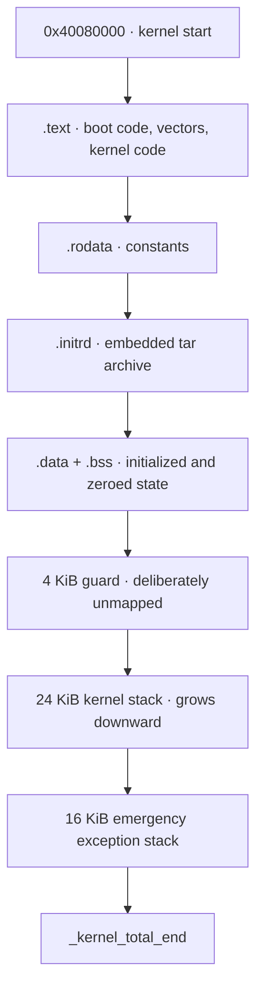

# RAM and virtual addresses

[Documentation home](../README.md) · [System map](System.md) · [Memory subsystem](../Kernel/Memory.md)

RAM is a physical resource shared by kernel and userland allocations. Address spaces map selected frames at virtual addresses; reserving a virtual range does not necessarily allocate physical backing for every page.

## Physical image and reservations

The linker places the kernel at **physical `0x40080000`**. Section end addresses depend on the build. The RAM base/size and other boot data come from platform discovery; no single RAM capacity is assumed here.

This is the linker's increasing-address order, with alignment between sections. The kernel stack grows toward the guard. The emergency stack is used when exception entry cannot safely build a frame on the normal stack; it has no guard of its own.

`.bss` and `NOLOAD` stack reservations occupy RAM without corresponding initialized bytes in the file image. The initrd is linked as actual image data.

## Other RAM consumers

| Consumer | Allocation/lifetime |
| --- | --- |
| Frame metadata | One `FrameInfo` record per 4 KiB frame; packed record fields target an 8-byte stride. |
| Page tables | Allocated as address spaces and mappings require them. |
| Kernel heap | Physical backing for slabs and larger kernel objects. |
| Process images, heaps and stacks | Resident frames backing user mappings. |
| Shared regions | Frames retained by capabilities and mappings across participants. |
| DMA buffers | Device-facing backing plus local mappings, under DMA authority. |
| Free blocks | Remaining RAM managed by the buddy allocator. |
| DTB reservation | Retained during discovery, reclaimed after the boot path releases borrowed views. |

These allocations can be interleaved in physical RAM. The [system diagram](System.md) groups them by purpose rather than inventing a contiguous layout.

## Kernel virtual mapping

| Property | Current value |
| --- | --- |
| Base page size | 4096 bytes |
| Kernel physical mapping offset | `0xFFFF800000000000` |
| Translation in the mapped physical window | `virtual = offset + physical` |
| Larger mapping unit used for eligible aligned RAM | 2 MiB level-2 block |
| Kernel/user roots | TTBR1 kernel mappings; TTBR0 process-side mappings |

The VMM applies section permissions and leaves the stack guard unmapped. Its mapping window is not permission to dereference every possible physical address. ASIDs distinguish user address spaces; mapping changes require the architecture's translation-maintenance operations.

## User virtual layout

These are **virtual addresses**, not physical RAM reservations.

| Boundary | Address | Meaning |
| --- | --- | --- |
| `TaskABI.userMin` | `0x0000008000000000` | Lower bound accepted by task range validation. |
| `TaskABI.programBase` | `0x0000008000400000` | Normal program image base. |
| `TaskABI.heapLimit` | `0x0000008020000000` | Upper limit of the conventional heap window; lower mmap boundary. |
| `UserSpaceLayout.mmapBase` | `0x000000803B000000` | Anonymous-mapping placement base. |
| `TaskABI.stackLimit` | `0x000000803C000000` | Lower stack-window limit. |
| `TaskABI.stackTop` | `0x000000803FFFE000` | Initial stack-top boundary. |
| `TaskABI.userMax` | `0x00007FFFFFFFF000` | Exclusive upper range-validation bound. |

The conventional image/heap/mmap/stack windows are much smaller than the full allowed user range. Guard pages, VMA permissions and actual backing determine which accesses succeed within those broad limits.

## Source entry points

[Linker script](../../linker.ld), [physical manager](../../Sources/ReixKernel/Memory/Physical/PhysicalPageManager.swift), [frame metadata](../../Sources/ReixKernel/Memory/Physical/FrameInfo.swift), [VMM](../../Sources/ReixKernel/Memory/Virtual/VirtualMemoryManager.swift), [TaskABI](../../Sources/ReixABI/Task/TaskABI.swift), [user layout](../../Sources/ReixKernel/Process/UserSpaceLayout.swift).
