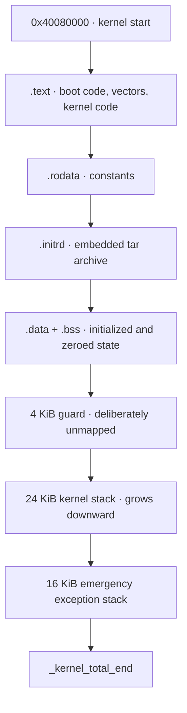

# RAM and virtual addresses

[Documentation home](../README.md) · [System map](System.md) · [Memory subsystem](../Kernel/Memory.md)

RAM is a physical resource shared by kernel and userland allocations. Address spaces map selected frames at virtual addresses; reserving a virtual range does not necessarily allocate physical backing for every page.

## Physical image and reservations

The linker places the kernel at **physical `0x40080000`**. Section end addresses depend on the build. The RAM base/size and other boot data come from platform discovery; no single RAM capacity is assumed here.

This is the linker's increasing-address order, with alignment between sections. The kernel stack grows toward the guard. The emergency stack is used when exception entry cannot safely build a frame on the normal stack; it has no guard of its own.

`.bss` and `NOLOAD` stack reservations occupy RAM without corresponding initialized bytes in the file image. The initrd is linked as actual image data.

## Other RAM consumers

| Consumer | Allocation/lifetime |
| --- | --- |
| Frame metadata | One `FrameInfo` record per 4 KiB frame; packed record fields target an 8-byte stride. |
| Page tables | Allocated as address spaces and mappings require them. |
| Kernel heap | Physical backing for slabs and larger kernel objects. |
| Process images, heaps and stacks | Resident frames backing user mappings. |
| Shared regions | Exactly the frames asked for, as one or more buddy blocks that need not be adjacent, retained by capabilities and mappings across participants. |
| DMA buffers | One contiguous block, rounded up to a power of two, plus local mappings, under DMA authority. A buffer whose physical address was published stays allocated after its last holder lets go: see below. |
| Free blocks | Remaining RAM managed by the buddy allocator, in power-of-two blocks of 4 KiB to 8 MiB. |
| DTB reservation | Retained during discovery, reclaimed after the boot path releases borrowed views. |

These allocations can be interleaved in physical RAM. The [system diagram](System.md) groups them by purpose rather than inventing a contiguous layout.

## DMA buffers and their quarantine

There is no IOMMU, so a device given a buffer's physical address can keep writing there after the driver that gave it has gone. A buffer is therefore in one of three states:

| State | Frames | Charge to the creator |
| --- | --- | --- |
| Held | In use by a capability, a mapping or a message in flight. | Charged for the whole block. |
| Released, address never published | Back in the free blocks at once. | Refunded at once. |
| Released, address published | Quarantined: out of the free blocks and counted as allocated until the device is declared reset. | A creator that is still alive keeps paying. |

`dmaReclaim` on the device's window, called after the holder has reset the device, offers the quarantined blocks bound to that window back to the physical manager. A block it takes returns to the free blocks and its creator is refunded. A block it refuses stays out with a record of why, and is never freed by a later reclaim. The kernel cannot verify the reset: the process holding a DMA-capable device window is inside the trusted base. See [Memory management](../Kernel/Memory.md#dma-quarantine) and [Memory syscalls](../Kernel/Syscalls/Memory.md).

## Kernel virtual mapping

| Property | Current value |
| --- | --- |
| Base page size | 4096 bytes |
| Kernel physical mapping offset | `0xFFFF800000000000` |
| Translation in the mapped physical window | `virtual = offset + physical` |
| Larger mapping unit used for eligible aligned RAM | 2 MiB level-2 block |
| Kernel/user roots | TTBR1 kernel mappings; TTBR0 process-side mappings |

The VMM applies section permissions and leaves the stack guard unmapped. Its mapping window is not permission to dereference every possible physical address. ASIDs distinguish user address spaces, and the kernel invalidates a user translation only under the tag of the space that changed it. A tag is reissued only after its space has been fully invalidated, so a new owner never sees stale entries. Code written through the kernel's alias is cleaned and, where the instruction cache needs it, invalidated before it can be fetched.

Boot-time `MIDR_EL1` selects `dc civac` for Cortex-A53 r0p0 through r0p2; other cores use `dc cvau` when a clean is needed. A clone reuses completed publication for unchanged shared code on VIPT and PIPT instruction caches.

SHM, DMA, device windows and the `brk` VMA require whole-region unmap; anonymous and raw initrd splits retain their fault and clone attributes. See [Translation and instruction-cache maintenance](../Kernel/Memory.md#translation-and-instruction-cache-maintenance).

## User virtual layout

These are **virtual addresses**, not physical RAM reservations.

| Boundary | Address | Meaning |
| --- | --- | --- |
| `TaskABI.userMin` | `0x0000008000000000` | Lower bound accepted by task range validation. |
| `TaskABI.programBase` | `0x0000008000400000` | Normal program image base. |
| `TaskABI.heapLimit` | `0x0000008020000000` | Upper limit of the conventional heap window; lower mmap boundary. |
| `UserSpaceLayout.mmapBase` | `0x000000803B000000` | Anonymous-mapping placement base. |
| `TaskABI.stackLimit` | `0x000000803C000000` | Lower stack-window limit. |
| `TaskABI.stackTop` | `0x000000803FFFE000` | Initial stack-top boundary. |
| `TaskABI.userMax` | `0x00007FFFFFFFF000` | Exclusive upper range-validation bound. |

The conventional image/heap/mmap/stack windows are much smaller than the full allowed user range. Guard pages, VMA permissions and actual backing determine which accesses succeed within those broad limits.

## Source entry points

[Linker script](../../Build/linker.ld), [physical manager](../../Sources/Kernel/Memory/Physical/PhysicalPageManager.swift), [frame metadata](../../Sources/Kernel/Memory/Physical/FrameInfo.swift), [VMM](../../Sources/Kernel/Memory/Virtual/VirtualMemoryManager.swift), [TaskABI](../../Sources/ABI/Task/TaskABI.swift), [user layout](../../Sources/Kernel/Process/UserSpaceLayout.swift).
