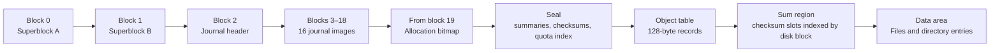

# Disk and RxFS layout

[Documentation home](../README.md) · [Storage services](../Userland/Storage.md) · [RAM layout](Memory.md)

The persistent volume uses **RxFS**, identified by the magic `REIXFS` followed by two zero bytes. The magic carries no version number and there is no migration. Another recognised layout, including a superblock valid under the former FNV-1a checksum, is refused as `unrecognised`; other invalid superblock checksums or journal protocols are `corrupt`. Neither refusal formats the disk. Existing images need `make clean-image`. The kernel's embedded tar initrd has a separate format and lifetime.

The virtio-block backend exposes 512-byte sectors. RxFS groups eight sectors into a **4096-byte block**. The filesystem plan requires the backend's sector size to divide its block size exactly.

## Volume layout

Arrows show increasing block order. Region sizes are not drawn to scale. [FSLayout](../../Sources/Libraries/FS/FSLayout.swift#L16) calculates them from volume geometry; mount checks the stored layout against that plan.

| Region | Calculation |
| --- | --- |
| Fixed prefix | 19 blocks: two superblocks, one journal header, sixteen payload blocks. |
| Bitmap | One bit per volume block, rounded up to whole blocks. |
| Seal | `32 + 8 × bitmapBlocks + 4 × (tableBlocks + sumBlocks) + 8 × min(objects, 1024)` bytes, rounded up to whole blocks. |
| Object table | Nominally one object per 16 KiB of volume capacity; records occupy 128 bytes and the table is rounded to blocks. |
| Sum region | Four bytes per volume block, indexed by block number, rounded up to whole blocks. Table, folder and file blocks use their slots. |
| Data start | `19 + bitmapBlocks + sealBlocks + tableBlocks + sumBlocks`. |
| Root object | Object 0; represents the machine container. |

## Concrete geometries

| Volume | Total blocks | Bitmap blocks | Seal blocks | Object-table blocks | Sum blocks | First data block |
| --- | --- | --- | --- | --- | --- | --- |
| 16 MiB | 4096 | 1 | 3 | 32 | 4 | 59 |
| 256 MiB | 65536 | 2 | 3 | 512 | 64 | 600 |
| 1 GiB | 262144 | 8 | 5 | 2048 | 256 | 2336 |

`mount` and `format` refuse volumes above **262144 blocks / 1 GiB** before reading a byte. `FSLayout.maxSupportedBlocks` records the recovery service level used to choose the limit: one second, modelled as host time plus 50 µs per device read. The current `ScaleTests` gates measure device work rather than host speed: the most reads of three samples must fit the baseline plus ten percent on supported geometries. Host timings are reported, not asserted. The separate recovery-shape bound remains in place.

| Volume | Sealed clean reads | Dirty reads | Mending reads |
| --- | --- | --- | --- |
| 16 MiB | 8 | 402 | 468 |
| 256 MiB | 9 | 1903 | 2930 |
| 1 GiB | 17 | 6709 | 10814 |
| 2 GiB, measurement only | 27 | 13117 | 21326 |

These are the measurements documented in `FSLayout`; [ScaleTests.mountMatrix](../../Tests/Libraries/FS/ScaleTests.swift#L205) measures the same recovery shapes. Its stored gate baselines are separate from this table. The measurement path can open the unsupported geometry; the public mount cannot.

## Records that define the format

| Record | Size / important fields |
| --- | --- |
| Superblock header | 112 defined bytes within a block: magic, geometry, root object, state, machine name, generation, journal information, seal start/length/checksum (offsets 88, 92, 96), sum-region root (100), commit marker (104) and checksum (108). |
| `FSObject` | 128 bytes: kind/flags, block count, byte size, timestamps, quota/use, container/parent/generation and 8 extent slots. |
| Extent | 8 bytes: `start: UInt32`, `count: UInt32`. |
| Directory entry | 64 bytes: object ID at byte 0, name length at byte 4, a 24-bit check at bytes 5–7, up to 56 name bytes starting at byte 8. A free entry is all zero; an invalid encoding is impossible, not free. |
| Machine name | Up to 24 bytes in the superblock. |

Object extent slots start at byte 64. The encoders specify byte offsets; Swift in-memory layout is not an implicit disk serializer. [FSSuperblockField](../../Sources/Libraries/FS/FSSuperblockField.swift#L13) defines the superblock offsets.

The superblocks alternate publication with generations and checksums. A transaction changing the sum region stages the non-live copy, one generation higher, with the new root and no seal. That copy becomes live when applied. Losing the newest copy immediately after such a change can leave a valid older copy whose root disagrees with the medium; mount refuses that disagreement.

## Integrity checks and the seal

All checksum fields use **CRC32C (Castagnoli)**, replacing FNV-1a at the same 32-bit fields and byte offsets. `FSChecksum` reads a record's own checksum field as zero and can continue a checksum across pieces. Freestanding programs use the generated `reix_crc32c` assembly routine (`crc32cx` over eight-byte chunks); host tests and disk provisioning use the equivalent slicing-by-eight Swift implementation. The current Cortex-A53 platform requires the CRC instructions without a runtime feature probe.

A superblock that fails CRC32C but validates under FNV-1a is an older format, not evidence of damage: mount returns `unrecognised` and leaves the disk untouched. Only its superblocks are inspected; the old volume is neither migrated nor mounted. Recreate disposable development images with `make clean-image`.

The sum region records the checksum of every table, folder and file block at that block's index. Table and folder images stage their checksums in the same transaction. File writes stage checksums before writing data to its home. The filesystem also keeps the expected checksum of every bitmap, table and sum block in scratch memory, checking reads against it and updating it only for accepted writes.

[FileSystem.sumRoot](../../Sources/Libraries/FS/FileSystem.swift#L782) checksums the checksum of **every** sum block, in block order, including unused pages. The superblock carries that root. Every transaction staging a sum block also stages the superblock image carrying the resulting root, last, in the same redo transaction. The root is an integrity account on this medium, not authentication or protection against rolling back the whole disk.

A clean `unmount` checks the block map, rooms and names before sealing. It does not scan file bytes. The seal holds bitmap checksums and used counts, table and sum-block checksums, and the container quota index. It is durable before the clean mark names its checksum; a mounted mark names no seal. A check that cannot seal leaves a clean mark without a seal, requiring a full metadata scan on the next mount.

| Mount | What it checks before serving |
| --- | --- |
| Clean, sealed, quiet journal | Seal checksum, generation and shape; the root computed from its sum-block checksums against the superblock; every bitmap against its summary; quota-index total against the map; root object's table block. No sum-region read is needed to cross-check the seal's root. Other table, sum and folder blocks are checked when read. |
| Clean, absent or invalid seal | Recover the journal, read the whole sum region and compare its root with the superblock, then scan metadata in full. A valid seal contradicted by the root, map or root object refuses the mount instead of falling back to repair. |
| Dirty | Recover the journal, check the whole sum region against the root, then `putRight`: derive the block map from the checked table, put rooms right and check names. |

A root mismatch holds the volume before table or folder records are believed or an overwrite settle restages a sum block. A table or folder checksum mismatch quarantines the volume, stops the walk and is not repaired. Dirty recovery can derive a changed bitmap from the checked table; a sealed mount or live scrub refuses a bitmap that contradicts its known checksum.

A file-data mismatch is **`FSStatus.damaged`**. A read reports progress only up to the damaged block. A partial write that must retain damaged bytes is refused; a whole-block replacement can repair them. The volume remains serviceable because other metadata does not depend on file contents. Plain reads, pipelined reads, partial-block writes and compaction copies all check data.

`scan(.everything)` checks metadata. `scan(.data)` also reads the whole sum region against the known root, including unused pages, then every file block against its checksum. It counts `damagedData` without making that alone unsafe to serve. A stopped table, folder, room or data walk remains incomplete; incomplete findings cannot authorize repair. A device that lies about durability, a checksum collision or a coherent rollback of all the relevant on-disk accounts remains outside these checks.

## Commit and interrupted overwrites

The redo journal holds at most **16 block after-images**. It covers bitmap, table, sum and folder blocks, superblocks carrying a root, and the partly filled last file block a write starts in. Other file data goes to its home directly.

1. Collect images in the transaction. If the write overwrites existing blocks in place, first make its declaration durable: the runs of block addresses and each block's new checksum in a `prepared` header.
2. Write the journal payloads and a `prepared` header, then issue a durability barrier.
3. Publish the `committed` header and issue a barrier.
4. Apply images to their home blocks and issue a barrier.
5. Write the empty checkpoint and finish with its barrier.

The header uses **protocol version 2**. Its transaction stamp is **128 bits**, with a **64-bit superblock generation** and a **64-bit transaction step**, encoded as two words and retained in empty checkpoints. The last superblock generation cannot begin a transaction because a root image may need its successor; exhaustion refuses rather than wraps. Earlier journal protocols are refused before any write.

Recovery validates stamp, target ranges, payload checksums and any superblock image's complete layout before replay. A committed journal carrying the selected live superblock is replayed even when its stamp names the preceding generation: the root's home write can land before the other images. This does not authorize replay of an unrelated stale journal.

A prepared header discards uncommitted structural images but must settle any declared in-place overwrite. The declaration holds up to eight runs and **896 blocks** (`FSLayout.overwriteLimit`), with new checksums in the header after its first 512 bytes and a separate check over them. Its sum-block reach must fit alongside the root image in one transaction; `FSJournal.Intent.fits` conservatively counts each run's reach and requires fewer than sixteen sum-block reaches.

The settle reads each named block. Bytes matching the declared new checksum take that checksum; bytes matching the old one keep it. Anything matching neither retains the old checksum and reads as `damaged`, including rot or a torn overwrite. Unnamed checksums do not change. A missing or torn declaration checksum permits only the old account: data writes cannot start until the declaration is durable.

A settle is its own transaction, carrying the same declaration through its prepared and committed headers and staging checksum changes with their root. A cut before commit leaves the declaration to judge again; a cut after commit leaves redo images to replay. Abandoning a live write or a later `begin` also settles a declaration before clearing it. Failure within a settle does not recurse into another settle.

A write starting inside the file's partly filled last block journals that block's complete image and checksum at its existing address. After a cut the tail is old or new, whole, and its extent does not change. The image consumes a journal slot. Whole blocks overwritten in place use the declaration path; arbitrary file writes are not atomic. A committed overwrite whose apply failed can read as damaged until remount replays its checksum.

## Consented re-anchor

Mount never re-anchors a refused root. [FileSystem.reanchorOffered](../../Sources/Libraries/FS/FileSystem.swift#L450) is a separate read-only eligibility check. It accepts only a root disagreement whose complete data scan finds nothing else: table and folder blocks match the medium's sums, map, names and rooms agree with the table, and all file blocks match. Other refusal kinds, a committed journal, any outstanding overwritten-data intent, exhausted stamps, incomplete scans and additional findings are ineligible. A clean seal's bitmap refusal remains a refusal.

After the parent consents, [FileSystem.reanchor](../../Sources/Libraries/FS/FileSystem.swift#L464) repeats the check against the medium. It stages both superblocks with the accepted root, mounted state and no seal in one redo transaction. It preserves the journal step because no new mount generation was published. A prepared header without overwritten data may be discarded only after consent; a committed repair is replayable by mount.

Re-anchoring deliberately trusts the medium's sum region. A stale table together with its matching stale sums can pass this scan; the check cannot distinguish that pair from current metadata. [Init's consent path](../Userland/Storage.md#mount-refusal-and-consent) states this trust decision before authorizing it.

## Source entry points

[Geometry](../../Sources/Libraries/FS/FSLayout.swift), [superblock offsets](../../Sources/Libraries/FS/FSSuperblockField.swift), [seal format](../../Sources/Libraries/FS/FSSeal.swift), [sealing and believing it](../../Sources/Libraries/FS/FileSystemSeal.swift), [object encoding](../../Sources/Libraries/FS/FSRecords.swift), [directory encoding](../../Sources/Libraries/FS/FSEntry.swift), [journal](../../Sources/Libraries/FS/FSJournal.swift), [transaction state](../../Sources/Libraries/FS/FSTransaction.swift), [commit/recovery](../../Sources/Libraries/FS/FileSystem.swift), [scans and repair](../../Sources/Libraries/FS/FileSystemRepair.swift).
