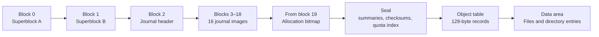

# Disk and RxFS layout

[Documentation home](../README.md) · [Storage services](../Userland/Storage.md) · [RAM layout](Memory.md)

The persistent volume uses **RxFS**, identified by the magic `REIXFS` followed by two zero bytes. The magic carries no version number: the format changes in place and there is no migration. A disk laid down by an earlier layout, such as the old `REIXFS02`, is refused as `unrecognised` and left untouched. Existing images need `make clean-image`. The kernel's embedded tar initrd is a different filesystem with a different lifetime and loading path.

The current virtio-block backend exposes 512-byte sectors. RxFS groups eight of those sectors into a **4096-byte block**. The filesystem plan also checks that a backend's sector size divides its block size exactly.

## Volume layout

Arrows show increasing block order. Region sizes are not drawn to scale. Bitmap/table lengths are calculated from volume geometry and checked against stored metadata on mount.

| Region | Calculation |
| --- | --- |
| Fixed prefix | 19 blocks: two superblocks, one journal header, sixteen payload blocks. |
| Bitmap | One bit per volume block, rounded up to whole blocks. |
| Seal | `32 + 8 × bitmapBlocks + 4 × tableBlocks + 8 × min(objects, 1024)` bytes, rounded up to whole blocks. |
| Object table | Nominally one object per 16 KiB of volume capacity; records occupy 128 bytes and the table is rounded to blocks. |
| Data start | `19 + bitmapBlocks + sealBlocks + tableBlocks`. |
| Root object | Object 0; represents the machine container. |

## Concrete geometries

| Volume | Total blocks | Bitmap blocks | Seal blocks | Object-table blocks | First data block |
| --- | --- | --- | --- | --- | --- |
| 16 MiB | 4096 | 1 | 3 | 32 | 55 |
| 256 MiB | 65536 | 2 | 3 | 512 | 536 |
| 1 GiB | 262144 | 8 | 5 | 2048 | 2080 |

`mount` and `format` refuse volumes above **262144 blocks / 1 GiB** (`FSLayout.maxSupportedBlocks`) before reading a byte. The limit is measured: a dirty mount must recover in under one second, counting host time plus 50 µs per device read. At 1 GiB the worst recovery models at about 0.7 s; at 2 GiB it models at about 1.4 s. `ScaleTests` keeps the measurements, and the table is in `FSLayout.swift`.

## Records that define the format

| Record | Size / important fields |
| --- | --- |
| Superblock header | 108 defined bytes within a block: magic, geometry, root, state, machine name, generation, journal information, seal start/length/checksum (offsets 88, 92, 96), commit (100) and checksum (104). |
| `FSObject` | 128 bytes: kind/flags, block count, byte size, timestamps, quota/use, container/parent/generation and 8 extent slots. |
| Extent | 8 bytes: `start: UInt32`, `count: UInt32`. |
| Directory entry | 64 bytes: object ID at byte 0, name length at byte 4, a 24-bit check over the entry at bytes 5–7, up to 56 name bytes starting at byte 8. A free entry is all zero; anything else that does not check out reads as impossible. |
| Machine name | Up to 24 bytes in the superblock. |

Object extent slots start at byte 64. The encoder/decoder specifies field offsets explicitly; Swift in-memory layout is not used as an implicit disk serializer. Readers validate record encodings and reject inconsistent metadata rather than treating invalid fields as valid free space.

The two superblocks provide alternate publication locations with generations and checksums. Mount selects a valid record; it never treats an unrecognised layout as a blank disk to overwrite.

## Integrity checks and the seal

The filesystem keeps a checksum of every bitmap and table block in its scratch memory. It updates the checksum on every write the device accepts and compares it on every read. A block that changed behind the filesystem's back is refused on its first read, and the volume is held read-only. A write the device refuses keeps the old checksum.

A clean `unmount` runs the full check: one pass over the object table for the block map, then every container's room and every name. Only a volume that passes is sealed. The seal holds each bitmap block's checksum and used count, each table block's checksum, and the quota index of every container. It is made durable before the clean mark, which names it by checksum; a mounted mark names no seal. If the check finds anything, the disk is marked clean without a seal, and the next mount checks it in full and refuses it.

| Mount | What it does |
| --- | --- |
| Clean, sealed | Reads the seal, compares every bitmap block with its summary, the quota-index total with the map, and the root's table block with its checksum. Then it serves: 8 reads at 16 MiB, 17 at 1 GiB. |
| Clean, no valid seal | A seal that does not checksum, has another generation or shape, or sits over a non-empty journal is not believed. The mount runs the full scan. |
| Dirty | Replays the journal, repairs the block map, then the room, then checks the names. |

Where each kind of damage is caught:

| Caught at | Damage |
| --- | --- |
| Mount | Any change to a bitmap block, the seal or the root's table block made while the disk was shut down. |
| First read | Any other table block that changed, and any damaged directory entry. |
| Unmount | Metadata that disagrees with itself but has valid checksums, written during a session: map against table, total and per-container room, duplicate or stray names, blocks claimed twice. |
| Not caught | File data blocks, which have no checksums; a plausible table rot before a crash, because a dirty mount learns its checksums from the medium; a device that lies about `FLUSH`. |

## Structural commit

1. Collect at most 16 structural block after-images in the transaction.
2. Write journal payloads and a `prepared` header, then issue a durability barrier.
3. Publish the `committed` header and issue another barrier.
4. Apply the journal images to their target blocks and issue a barrier.
5. Clear/checkpoint the journal and finish the transaction.

Recovery discards a prepared transaction. It validates the generation, target ranges and payload checksums of a committed journal before replay. Invalid persistent state can quarantine the volume.

This journal covers structural images. It is not a claim that arbitrary file-data writes are atomic. Persistence also depends on the block backend's reported durability and barrier behavior.

## Source entry points

[Geometry](../../Sources/ReixFS/FSLayout.swift), [superblock offsets](../../Sources/ReixFS/FSSuperblockField.swift), [seal format](../../Sources/ReixFS/FSSeal.swift), [sealing and believing it](../../Sources/ReixFS/FileSystemSeal.swift), [object encoding](../../Sources/ReixFS/FSRecords.swift), [directory encoding](../../Sources/ReixFS/FSEntry.swift), [journal](../../Sources/ReixFS/FSJournal.swift), [transaction state](../../Sources/ReixFS/FSTransaction.swift), [commit/recovery](../../Sources/ReixFS/FileSystem.swift).
