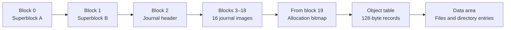

# Disk and RxFS layout

[Documentation home](../README.md) · [Storage services](../Userland/Storage.md) · [RAM layout](Memory.md)

The persistent volume uses **RxFS format `02`**, identified by the bytes `REIXFS02`. The kernel's embedded tar initrd is a different filesystem with a different lifetime and loading path.

The current virtio-block backend exposes 512-byte sectors. RxFS groups eight of those sectors into a **4096-byte block**. The filesystem plan also checks that a backend's sector size divides its block size exactly.

## Volume layout

Arrows show increasing block order. Region sizes are not drawn to scale. Bitmap/table lengths are calculated from volume geometry and checked against stored metadata on mount.

| Region | Calculation |
| --- | --- |
| Fixed prefix | 19 blocks: two superblocks, one journal header, sixteen payload blocks. |
| Bitmap | One bit per volume block, rounded up to whole blocks. |
| Object table | Nominally one object per 16 KiB of volume capacity; records occupy 128 bytes and the table is rounded to blocks. |
| Data start | `19 + bitmapBlocks + tableBlocks`. |
| Root object | Object 0; represents the machine container. |

## Concrete geometries

| Volume | Total blocks | Bitmap blocks | Object-table blocks | First data block |
| --- | --- | --- | --- | --- |
| 16 MiB | 4096 | 1 | 32 | 52 |
| 256 MiB | 65536 | 2 | 512 | 533 |

Format `02`'s current public mount/format path limits supported volumes to **65536 blocks / 256 MiB**. This is a code-level limit, not a performance measurement made for this documentation.

## Records that define the format

| Record | Size / important fields |
| --- | --- |
| Superblock header | 96 defined bytes within a block: magic, geometry, root, state, machine name, generation, journal information, commit and checksum. |
| `FSObject` | 128 bytes: kind/flags, block count, byte size, timestamps, quota/use, container/parent/generation and 8 extent slots. |
| Extent | 8 bytes: `start: UInt32`, `count: UInt32`. |
| Directory entry | 64 bytes: object ID at byte 0, name length at byte 4, reserved bytes 5–7, up to 56 name bytes starting at byte 8. |
| Machine name | Up to 24 bytes in the superblock. |

Object extent slots start at byte 64. The encoder/decoder specifies field offsets explicitly; Swift in-memory layout is not used as an implicit disk serializer. Readers validate record encodings and reject inconsistent metadata rather than treating invalid fields as valid free space.

The two superblocks provide alternate publication locations with generations and checksums. Mount selects a valid supported record; it does not treat an unsupported RxFS version as a blank disk to overwrite.

## Structural commit

1. Collect at most 16 structural block after-images in the transaction.
2. Write journal payloads and a `prepared` header, then issue a durability barrier.
3. Publish the `committed` header and issue another barrier.
4. Apply the journal images to their target blocks and issue a barrier.
5. Clear/checkpoint the journal and finish the transaction.

Recovery discards a prepared transaction. It validates the generation, target ranges and payload checksums of a committed journal before replay. Invalid persistent state can quarantine the volume.

This journal covers structural images. It is not a claim that arbitrary file-data writes are atomic. Persistence also depends on the block backend's reported durability and barrier behavior.

## Source entry points

[Geometry](../../Sources/ReixFS/FSLayout.swift), [superblock offsets](../../Sources/ReixFS/FSSuperblockField.swift), [object encoding](../../Sources/ReixFS/FSRecords.swift), [directory encoding](../../Sources/ReixFS/FSEntry.swift), [journal](../../Sources/ReixFS/FSJournal.swift), [transaction state](../../Sources/ReixFS/FSTransaction.swift), [commit/recovery](../../Sources/ReixFS/FileSystem.swift).
