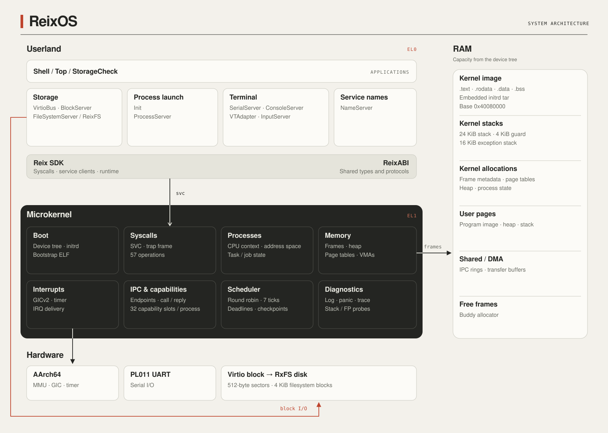

# System map

[Documentation home](../README.md) · [Kernel overview](../Kernel/Overview.md) · [RAM layout](Memory.md) · [Disk layout](Storage.md)

The map groups the current kernel and userland responsibilities and shows where RAM and persistent storage participate. Boxes are conceptual groups; they are not proportional allocations or a complete call graph.

[Open the scalable diagram](Assets/System.svg).

## Read it in three steps

1. **Execution:** EL0 programs use the Reix SDK to enter the EL1 syscall path. The kernel validates authority, changes state and returns to the current or newly selected process.
2. **Memory:** RAM backs kernel code/state and user pages. Each process sees virtual mappings, not a dedicated physical RAM bank. Shared/DMA regions require explicit authority.
3. **Persistence:** the embedded initrd lives in RAM with the kernel image. RxFS lives on a separate block device reached through userland storage services.

## Paths across the system

| Operation | Path |
| --- | --- |
| Bootstrap service | Kernel tar/ELF path → process creation → scheduler → EL0 service. |
| Ordinary application launch | Client → ProcessServer → FileSystemServer → ELF plan → task syscalls → child bootstrap → job result. |
| File read | Application → FileSystemServer/ReixFS → BlockServer/VirtioBlock → disk → shared transfer window → application. |
| Terminal output | Application text surface → VTAdapter → ConsoleServer → SerialServer → UART. |
| Timer preemption | Virtual timer → GIC → kernel tick handler → reschedule request → exception-return switch. |
| Device completion | Device IRQ → GIC → kernel interrupt owner → userland driver → service completion. |

The shared definitions in `ReixABI` describe these boundaries. Their location in a shared module does not move userland policy into the kernel.

Sources: [kernel composition](../../Sources/ReixKernel/Core/Kernel.swift), [exception path](../../Sources/ReixKernel/Arch/aarch64/Exceptions/Handlers/ExceptionHandler.swift), [Init](../../Sources/Userland/Init/Init.swift), [build targets](../../Package.swift).
