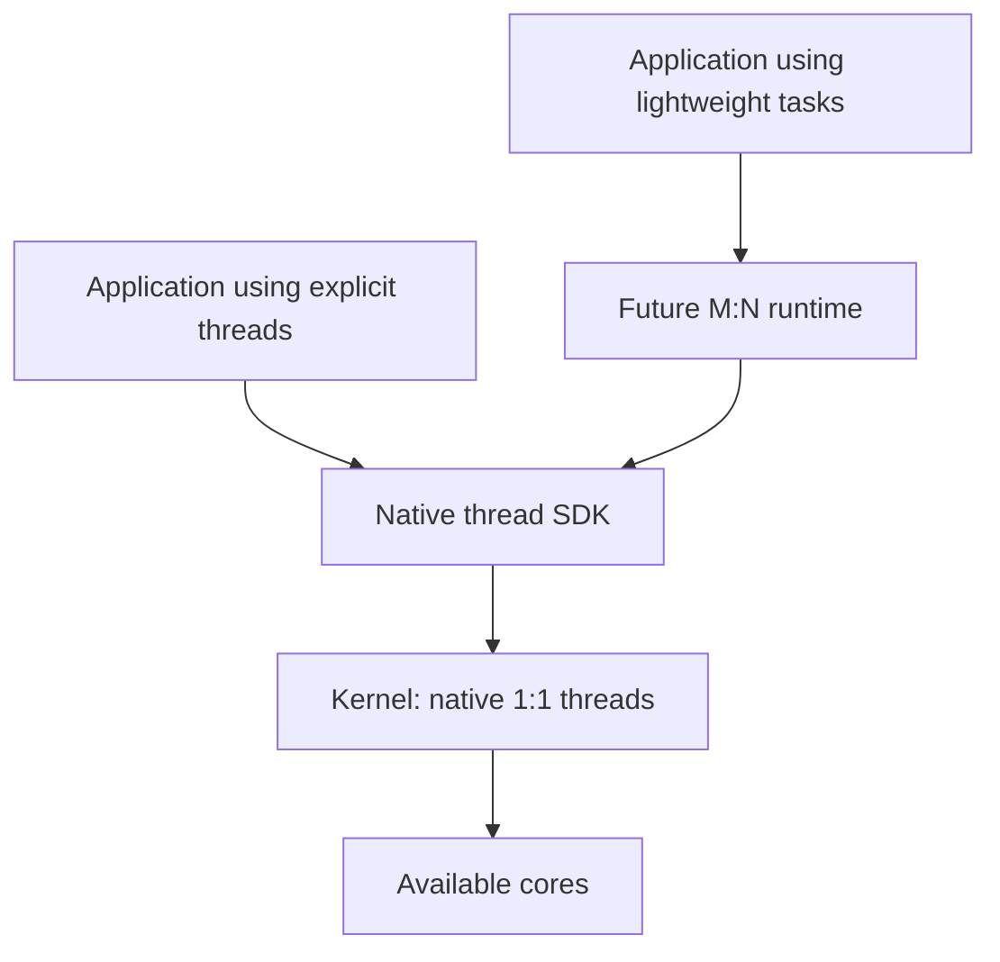

# Threads and tasks in ReixOS

> Proposal for a future feature. The current design covers native 1:1 threads.
> Lightweight M:N tasks will be a userland extension.

## 1. Architecture

The kernel schedules native threads. Applications use them through the SDK,
or delegate work to a runtime that distributes many tasks across a small set
of threads. The 1:1 layer must work without that runtime.



| Layer | Responsibilities |
|---|---|
| **1:1 kernel** | Threads, scheduling, memory, IPC, waiting and waking |
| **Userland SDK** | Thread APIs, mutexes and a synchronized heap |
| **Future M:N runtime** | Task creation, worker scheduling, suspension and resumption |

The SDK and runtime are libraries running inside the process that uses them.
The M:N runtime does not require a central server to schedule application tasks.

### Terms

| Term | Meaning |
|---|---|
| **Process** | Owner of the address space and capabilities; security principal |
| **Native thread** | Execution context represented and scheduled by the kernel |
| **TCB** | *Thread Control Block*: the kernel structure describing a thread |
| **1:1** | One thread exposed by the SDK corresponds to one kernel thread |
| **Lightweight task / green thread** | Unit of execution managed by the userland runtime; candidate name: `rxTask` |
| **Worker** | Native thread used by the runtime to execute tasks |
| **M:N** | Many tasks distributed across a set of native threads |

The 1:1 relationship is independent of core count and stack ownership.
Throughout this document, “thread” means a native thread and “task” means a
userland task.

## 2. Design choices

- Native **1:1 threads** in the kernel.
- **One kernel stack per CPU**, following the seL4 approach.
- **TCBs allocated on demand**, with an expandable registry and memory budgets.
- Waiting primitives that let threads yield the CPU instead of repeatedly polling.
- Fairness between processes: creating more threads must not, by itself,
  increase a process's CPU share.
- A future **M:N runtime with tasks that are simple to start**, in the spirit
  of goroutines and the lightweight processes used by Gleam on BEAM.

Start with one core. The move to SMP will preserve object ownership and add
the synchronization needed between CPUs.

## 3. Process, address space and TCB

| Object | Contents | Release condition |
|---|---|---|
| `Process` | Identity, capabilities, address space, thread list and accounting | Threads have exited and notification and reaping obligations are complete |
| `AddressSpace` | Mappings and virtual memory structures | No thread or kernel path can still use it |
| `Thread` / TCB | Identity, CPU context, scheduling state, TLS and waits | No CPU, queue or wait retains an active reference |

Threads in the same process share memory and capabilities. Isolation remains
between processes. Each thread owns its CPU context and userland stack; the
kernel stack belongs to the CPU.

An address space has one owning process. Shared memory between processes
consists of regions mapped into their respective address spaces.

### Identifiers

The process identity represents authority. The thread identifier tracks a
thread through its lifetime.

The thread registry must detect stale identifiers. Slots and generations are
one candidate: reusing a slot must not make an old identifier resolve to the
new thread.

Shrinking the registry must preserve this guarantee when freeing an empty
block. Identifier encoding, generation retention and exhaustion handling
remain to be defined.

## 4. One kernel stack per CPU

When a thread waits for an event:

1. The kernel records the wait and the context needed to resume.
2. It finishes the syscall path up to a safe switching point.
3. It reuses the CPU's kernel stack to execute other work.
4. When the event occurs, it makes the waiting thread runnable again.

The thread keeps its userland stack. None of its call frames remain suspended
on the kernel stack.

seL4 uses one kernel stack per core. Zircon instead associates a kernel stack
with each thread. ReixOS adopts the former stack model; its scheduler and
synchronization still need their own design.

### Long operations

Long operations advance in bounded steps. When they yield execution, they save
the required state in the thread. The internal API for expressing them will be
designed separately from the userland task runtime.

Before servicing interrupts or switching threads, queues and mappings must be
consistent. A freed TCB must not remain referenced by timers, IRQ waits or CPU
state.

On one core, locks can be omitted only where interrupt and execution-switching
rules exclude concurrent access. A shared kernel stack does not provide that
protection by itself.

Stack sizes, headroom and exception areas will be established through
measurements that include nested exceptions.

## 5. Memory and capacity

Each TCB stays compact and stable. The number of allocated TCBs and the
registry's capacity grow within the available budget.

| Resource | Proposed policy |
|---|---|
| TCB | Allocate when creating a thread |
| Registry | Grow in blocks without moving live TCBs |
| Global budget | Limit total thread memory |
| Per-process budget | Limit each process's consumption |
| Reserve | Keep resources for essential services and completion of admitted operations |
| Empty blocks | Reclaim when compatible with identifier validity |

The cost includes the TCB, CPU context, userland stack, mappings, waits and a
share of the registry. Creation reserves the budget before making the thread
runnable; failure rolls back allocations and charges.

If free memory decreases, new thread creation is restricted. Existing threads
keep the resources already assigned to them.

### Maximum capacity and operating point

**Maximum capacity** depends on the budgets and the registry's technical limit.
The **optimal operating point** depends on how many runnable threads improve
throughput and latency for the workload and available cores.

More RAM allows more threads to exist, but does not always make it useful to
run more of them in competition. The limit will be calibrated through
measurements, including configurations with 4 MiB of RAM. TCB size and
per-thread cost will be checked against the implemented layout.

The future runtime will have its own task limit and worker count, both subject
to the process's budgets.

## 6. Scheduling and lifecycle

### Scheduling

The policy must distribute CPU time between processes and, within each process,
between threads. A process must not gain more CPU simply by multiplying its
runnable threads.

Measurements will include queue latency, context switches, waiting time and
contention. The algorithm, priorities and priority inversion handling remain
open. SMP will also require decisions on migration, queues and lock ordering.

### Creation and exit

Creation checks authority and budgets, prepares the TCB, context and stack,
then links the thread into the process and scheduler structures. Every fallible
stage must be reversible.

Exit removes the thread from queues, cancels waits and deadlines, and releases
IPC references. A result intended for `join` survives as specified by the API,
without retaining the entire TCB unnecessarily.

Process termination prevents new thread creation and brings existing threads
to completion. On SMP, freeing a TCB requires confirmation that no CPU is using
it. The address space is released after its last use by threads and the kernel.

### TLS and statistics

TLS belongs to the native thread. On AArch64, `TPIDR_EL0` is saved and restored
when switching threads, including changes made in userland. A task that moves
between workers needs its own local state, managed by the runtime.

Process accounting sums the consumption of live threads and the accumulated
consumption of exited threads, without counting open intervals twice.
Per-thread statistics must show CPU consumption and reasons for waiting.

## 7. Virtual memory

Two threads in the same process can modify or use the same regions. The kernel
must ensure that:

- The state of an interrupted operation belongs to the thread executing it.
- VMA references are revalidated before use when execution resumes.
- Buffer validation remains valid until the copy finishes.
- Faults, copy-on-write, mapping replacement and page-table reclamation preserve
  references and accounting.

A VMA mutation counter is one candidate for validating resumed operations.
It must be recorded after the completed step, at suspension, to detect changes
made while the thread was not executing.

Validation and copying must exclude interleaving on one core. On SMP, they also
need protection against access from other cores.

The proposed initial restriction on `split` allows cloning only when one thread
is live. Cloning a process with multiple threads requires defining what happens
to the other threads' stacks, locks and operations.

## 8. Waiting and synchronization

A thread finds a lock held and decides to wait. If the owner releases it between
the check and the thread going to sleep, the wakeup can be lost. The waiting
primitive must prevent this sequence.

| Alternative | Behavior | To be defined |
|---|---|---|
| **Park/unpark** | An early wakeup remains pending until consumed | Wait association, SDK queues, timeouts and cancellation |
| **Futex-style wait** | The kernel checks a word and atomically queues the thread if the value matches | Memory identity and lifetime, authorization and waking |

A futex keeps the uncontended case in userland and involves the kernel when
waiting is needed. It does not require a permanent object for every mutex.
Park/unpark still requires correct wait lists in the library.

The choice remains open. The comparison will cover RAM, syscall cost, latency
under contention, timeouts and cancellation.

| Layer | Responsibility |
|---|---|
| Kernel | Suspend and wake native threads |
| SDK | Build mutexes and protect the heap used by multiple threads |
| Future M:N runtime | Suspend tasks on its own waits and reuse workers |

A native mutex can block the worker using it. Runtime waits must instead allow
other tasks to execute. Locks whose ownership depends on the thread cannot
span a suspension that migrates the task.

## 9. Future M:N runtime: lightweight tasks

The goal is to start concurrent work as easily as calling a function. The
references are [Go goroutines](https://go.dev/tour/concurrency/1) and
[Gleam's lightweight processes on BEAM](https://gleam.run/news/gleam-v0.12-and-gleam-otp-v0.1-released/).
The runtime lives in userland and distributes tasks across native threads.

### Usage and naming

`rxTask` is a candidate name for the launch function; `RXTask<Result>` could be
the returned type. This pair distinguishes the operation from its handle and
reserves `Thread` for the native layer. Names and signatures remain open.

Proposed API example, not yet implemented:

```swift
let task = try rxTask {
    calculateChecksum(buffer)
}

// Other independent work.
let checksum = try task.join()
```

This is ordinary Swift syntax: a function, a closure and a typed result. The
basic case should take a few lines, without configuring an executor,
introducing a dedicated language or requiring `async` and `await` throughout
the call chain. Swift Concurrency may gain an integration later; it does not
define the Reix task model.

### Cost and behavior

- Creating a task does not create a dedicated native thread or TCB. The runtime
  can adjust its worker count separately within the budget.
- Memory and startup costs must allow substantially more tasks than native
  threads, within explicit task and memory limits.
- A task can call ordinary functions. Waits supported by the runtime must be
  able to suspend the task while leaving its worker available.
- Results, errors, cancellation and handle lifetime need defined behavior,
  including when the caller does not collect the result.

In the example, `join()` called from another task should suspend that task;
called from a thread outside the runtime, it requires a native wait. This
distinction is part of the API to be designed.

### Runtime implementation

Suspending an ordinary Swift call chain requires a state representation
compatible with the compiler, stack and ABI. An `rxTask` function that merely
queues a closure is not enough to provide that behavior.

Task stacks, memory growth and reclamation, suspension points and userland
preemption will be studied in the M:N design. Progress must be guaranteed even
when a task computes for a long time without waiting: kernel thread preemption
does not, by itself, give that worker's other tasks a turn.

I/O and IPC must integrate with the runtime. An ordinary blocking syscall
blocks the worker; calls that cannot be integrated need a separate, bounded
path. Captured values and shared memory also need safety rules. BEAM processes
have their own memory and isolation model; in ReixOS, the security boundary
remains the kernel process.

These choices belong to the M:N extension. The 1:1 kernel provides the threads
and primitives on which to build it.

## 10. Verification and open questions

Initial verification uses native threads and the SDK, without depending on
the M:N runtime.

| Area | Check |
|---|---|
| Per-CPU stack | No private activation remains suspended; peak usage measured with nested exceptions |
| Lifecycle | No freed TCB remains reachable from CPUs, IPC, timers or IRQs |
| Memory | No leak after creation and exit; complete rollback on every failure |
| Budgets | Per-process limits and reserves hold under pressure |
| Registry | Growth and reclamation preserve live TCBs and rejection of stale identifiers |
| VM | Concurrent faults, COW, unmap and copy do not use freed memory |
| Waits | No lost wakeups; one outcome among waking, timeout and termination |
| SDK | Heap integrity and mutex correctness under contention |
| Scheduling | Fairness between processes, correct accounting and measured latency |

Memory cost must include each process's first TCB, additional threads and
registry growth. Host tests, emulation, SMP and physical hardware remain
separate levels of verification.

Open decisions for the 1:1 layer:

- Native thread ABI, authorization, `join` and `detach`.
- Thread identifiers, including exhaustion handling.
- TCB layout, stack management and registry reclamation.
- Budgets, reserves and a maximum calibrated through measurements.
- Scheduling, priorities and priority inversion.
- Park/unpark or futex, with timeouts and cancellation.
- SMP synchronization and lock ordering, with no locks held across waits or
  points that yield execution.

## Kernel references

- [seL4: per-CPU stack selection during ARM boot](https://github.com/seL4/seL4/blob/master/src/arch/arm/kernel/boot.c).
- [seL4: threads and IPC waits](https://docs.sel4.systems/Tutorials/threads.html).
- [Zircon: Thread with KernelStack, source snapshot](https://fuchsia.googlesource.com/fuchsia/+/5d1ce55861354d65ec1bc3f66550c4eab26614a6/zircon/kernel/include/kernel/thread.h).
- [Zircon: futex](https://fuchsia.dev/fuchsia-src/reference/kernel_objects/futex).
- [Zircon: atomic check and wait](https://fuchsia.dev/reference/syscalls/futex_wait).
