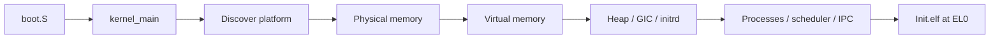

# Boot and kernel initialization

[Documentation home](../README.md) · [Kernel overview](Overview.md)

Boot constructs the memory managers and kernel objects, then loads `Init.elf` from the embedded tar archive. `Init` runs at EL0 and starts the services that form the rest of the system.

## What happens before EL0

1. `QemuVirtPlatform.discover` reads the device tree into `PlatformInfo`: RAM range, UART, GIC and virtio-MMIO transports.
2. `PhysicalPageManager` reserves the kernel, stacks, initrd and allocator metadata. The boot path drops borrowed DTB strings before reclaiming its pages.
3. `VirtualMemoryManager` builds kernel and process-side translation roots. The frame-metadata pointer is adjusted for the kernel mapping.
4. `Kernel` constructs `BucketsHeap`, `GICv2`, `TarFileSystem`, `ProcessManager`, `RoundRobin`, `RendezvousIPC` and `SyscallHandler`.
5. Timer and profiling initialization completes. The bootstrap ELF path loads `Init.elf` and enters user mode.

These managers are stored behind stable pointers in `Kernel`. Its aliases select concrete implementations at compile time. After boot, exception entry is the normal route back into the kernel.

## The embedded archive

`TarFileSystem` reads the archive in the linker's `.initrd` section. `ProcessManager.spawnProcess(path:)` uses the kernel ELF parser for bootstrap images. Open-file state is kernel-local; the archive itself is read-only and already resident in RAM.

The kernel still contains this path. Ordinary applications also have a separate disk-backed path through [ProcessServer](../Userland/ProcessLaunch.md); that path uses suspended-task syscalls instead of asking the kernel to read RxFS.

## Entry points worth knowing

| Function | Input | Return | Role |
| --- | --- | --- | --- |
| `kernelMain(dtbRawAddress:)` | `UInt64`, physical DTB address | `Void` | Exported as `kernel_main` for boot assembly. |
| `Kernel.boot(dtbRawAddress:)` | `PhysicalAddress` | `Void` | Initializes managers and enters the run path. |
| `ProcessManager.spawnProcess(path:)` | `UnsafePointer<CChar>` | `UnsafeMutablePointer<Process>`, throws `ProcessManagerError` | Constructs a process from an initrd ELF. |
| `TarFileSystem.residentBase(handle:)` | `FileHandle` | `PhysicalAddress?` | Finds resident archive backing for an opened file. |

## Source entry points

- [Kernel composition](../../Sources/ReixKernel/Core/Kernel.swift) and [entry symbol](../../Sources/ReixKernel/Core/KernelEntry.swift).
- [Platform discovery](../../Sources/ReixKernel/Platform/QemuVirt/QemuVirtPlatform.swift) and [platform data](../../Sources/ReixKernel/Platform/DeviceTree/Components/PlatformInfo.swift).
- [Tar filesystem](../../Sources/ReixKernel/FileSystem/Tar/TarFileSystem.swift) and [process loader](../../Sources/ReixKernel/Process/ProcessManager.swift).
- [Linker layout](../../linker.ld) and [userland bootstrap](../../Sources/Userland/Init/Init.swift).
