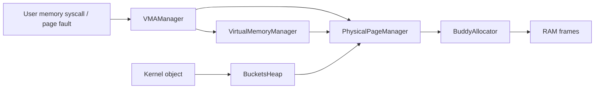

# Memory management

[Documentation home](../README.md) · [System map](../Architecture/System.md)

The memory subsystem answers three separate questions: which physical frames are owned, which virtual addresses are valid, and where kernel objects can be allocated. Its managers share ownership information, but serve different callers.

## Memory primitives

[`RawBytes`](../../Sources/Libraries/Memory/RawBytes.swift) supplies `fill`, forward `copy` and overlapping `copyBackward` in portable Swift. Kernel and userland `memcpy`, `memset` and `memmove` share it. All accesses are naturally aligned: 16-byte SIMD lanes when both copy addresses agree modulo 16, 8-byte lanes when they agree modulo 8, and pairs of byte accesses otherwise. Short and ragged ends remain in bounds. This alignment is required while boot still treats RAM as Device memory with the MMU disabled.

Kernel exceptions save the full FP/SIMD state before entering Swift, so vector memory operations use the existing context contract. Trap-frame copies use the same forward-copy primitive. `scripts/test/test-fpsimd-context.py` checks the context oracle, negative controls and emergency stack path in an isolated QEMU build.

Only kernel zero fills add an architectural fast path. `AArch64MMU.loadCacheType` reads `DCZID_EL0` once at boot with the cache policy. Zeroing four cache blocks or more can use `dc zva` over complete blocks, with `RawBytes.fill` on the edges, when the reported block is 16–2048 bytes and DZP permits it. Every call also checks that the MMU is enabled; otherwise it falls back to the shared fill. Userland has no `dc zva` or DCZID read.

The `vector-primitives` post-check reads the kernel and every linked program ELF: no recursive memory primitive or indirect call beneath it, vector paths present, and architectural zeroing confined to the kernel's `zero_blocks` and boot-only `read_dczid`. The primitives keep the image's size optimization; they do not request `@_optimize(speed)`.

## Physical frames

`PhysicalPageManager<BuddyAllocator>` manages RAM frames. It reserves boot-owned ranges, maintains one `FrameInfo` record per 4 KiB frame and delegates free-block allocation to the buddy allocator.

### Buddy allocator

`BuddyAllocator` is a binary buddy over one contiguous span of RAM, with orders 0 to 11: blocks of 4 KiB up to 8 MiB. A request above 8 MiB is refused. Its free state is kept per free block and not per page:

| State | Where | Meaning |
| --- | --- | --- |
| `freeHeads` | One bit per frame | Set exactly when that frame is the head of a free block. |
| `FreeBlock` node | Overlaid on the first bytes of each free block | Holds the block's order and its list links. Read only after the head bit says the block is free. |
| `freeLists` | One doubly linked list per order | The free blocks of that order. |

The three agree at every return: a bit is set if and only if its frame heads a block on the list its node names, free blocks never overlap, and no two free blocks of one order are buddies. Allocation takes the smallest non-empty order that fits and splits it down, pushing each upper half on its own list. Free merges upward while the buddy is a free block of exactly the current order, which is one bit and one byte to test. Both are bounded by the number of orders and do not depend on RAM size or on how many blocks are free.

`free` refuses before it writes anything. A block that is not aligned, not inside RAM or of an order above 11 is rejected; a block already free, or lying inside a free block, or covering a free block that starts after its first frame, is `.doubleFreeInvalid`. The last case needs a wrong, larger order and is also refused earlier by the page manager; the buddy repeats the check so it stays sound on its own. It is a scan of the block's head bits, done 128 frames (16 bytes) per NEON load. Donating a range at boot (`addFreeRange`) runs the same check once over the whole range, and every vector load is 16-byte aligned because donation runs before the MMU is on.

A request for contiguous pages still depends on the free block sizes as well as on total free RAM.

### Ownership and metadata

| Field | Type | Meaning |
| --- | --- | --- |
| `ramStart`, `ramSize` | `UInt64` | Discovered physical RAM extent. |
| `framesMetadata` | `UnsafeMutablePointer<FrameInfo>?` | Per-frame metadata array. |
| `totalPages`, `allocatedPages` | `UInt64` | Capacity and allocated-frame accounting. |
| `FrameInfo.refCount` | `UInt32` | References to a frame. |
| `FrameInfo.flags` | `PhysicalPageFlags` | `reserved` (withheld at boot), `kernel`, `user`, `dirty`, `heapLarge` and the manager's private `allocatorOwned`. |
| `FrameInfo.heapState` | `UInt16` | Slab free count or allocation bitmap, depending on bucket size. |
| `FrameInfo.orderAndShift` | `UInt8` | Buddy order in the low nibble and slab size shift in the high one. Order 15 marks a frame inside a block, not its head. |

`PhysicalPage` is an ownership-bearing allocation value. Consuming free operations transfer that ownership to the manager. Shared mappings use retain/release accounting; callers must not substitute a raw free for releasing one reference.

The all-zero `FrameInfo` representation means free, unowned and without a heap role. The packed fields target an 8-byte record stride. Kernel, allocator metadata, stacks and embedded initrd reservations are accounted for before normal allocation. At boot the frame metadata, the buddy's 192-byte free-list table and its head bitmap are laid out as one arena above the kernel image, rounded to a page once.

### What the page manager checks

| Operation | Refused when | Error |
| --- | --- | --- |
| `alloc` | Size is zero or negative, or a flag other than `kernel`, `user`, `dirty` or `heapLarge` is passed. | `allocationFailed(bytesNotValid)`, `invalidFlags` |
| `alloc` | A request that is not `.kernel` would leave 8 or fewer frames free (`reservePages`). Tested before the buddy is asked. | `allocationFailed(fullMemory)` |
| `alloc` | The buddy returns a block whose metadata is not free. | `metadataInconsistency` |
| `free`, `release`, `retain` | Address is not a whole frame inside RAM. | `invalidFrameAddress` |
| Same | Frame is inside a block, not its head. | `frameNotBlockHead` |
| Same | Frame was withheld at boot, or is `.kernel` and the call is the ordinary `free`. `freeOwnedKernelPage` allows the second. | `protectedMemoryViolation` |
| Same | Frame is not allocator-owned, or has no reference. | `frameNotAllocated`, `invalidRefCount` |
| `free` | The order given differs from the recorded one. | `pageOrderMismatch` |
| `retain` | The counter would wrap. | `referenceCountOverflow` |
| `free`, last reference | The buddy refuses the block. | `allocationFailed(reason)` carrying the buddy's refusal |

Every check finishes before the allocator or any metadata byte is changed. The eight reserved frames are spent only by `.kernel` allocations, which is what lets a teardown or a new slab page still succeed once user memory is exhausted.

`diagnose(_:order:)` is the read-only companion of a refused free. It reports what the books say about a block as a `PhysicalBlockState`: live, order mismatch, interior, free, reserved, kernel-owned, damaged or outside RAM. It never repairs anything, because it runs on books that may be wrong. The DMA quarantine uses it, see below.

See [RAM layout](../Architecture/Memory.md) for where these allocations fit.

### Main interfaces

| Function | Parameters | Returns | Meaning |
| --- | --- | --- | --- |
| [<code>PhysicalPageManager.alloc(_:flag:heapShift:)</code>](../../Sources/Kernel/Memory/Physical/PhysicalPageManager.swift#L109) | <code>_ bytes : Int, flag : PhysicalPageFlags = .none, heapShift: UInt8 = 0</code> | <code>PhysicalPage; throws(PPMError)</code> | Allocates a physical block large enough for the byte request; throws on allocation or validation failure. |
| [<code>PhysicalPageManager.free(_:)</code>](../../Sources/Kernel/Memory/Physical/PhysicalPageManager.swift#L223) | <code>_ page: consuming PhysicalPage</code> | <code>Void; throws(PPMError)</code> | Returns a consumed allocation to the allocator after ownership checks. |
| [<code>PhysicalPageManager.retain(_:)</code>](../../Sources/Kernel/Memory/Physical/PhysicalPageManager.swift#L264) | <code>_ address: PhysicalAddress</code> | <code>Void; throws(PPMError)</code> | Adds a frame reference; throws if the address or reference state is invalid. |
| [<code>PhysicalPageManager.release(_:)</code>](../../Sources/Kernel/Memory/Physical/PhysicalPageManager.swift#L293) | <code>_ address: PhysicalAddress</code> | <code>Void; throws(PPMError)</code> | Drops a frame reference and handles the last reference. |
| [<code>PhysicalPageManager.reclaimDeviceTree()</code>](../../Sources/Kernel/Memory/Physical/PhysicalPageManager.swift#L360) | <code>None</code> | <code>UInt64; throws(PPMError)</code> | Returns the number of reclaimed bytes; called after boot no longer needs DTB storage. |
| [<code>PhysicalPageManager.freeOwnedKernelPage(_:)</code>](../../Sources/Kernel/Memory/Physical/PhysicalPageManager.swift#L227) | <code>_ page: consuming PhysicalPage</code> | <code>Void; throws(PPMError)</code> | Like `free`, but accepts a `.kernel` block; used for page tables and other kernel-owned pages. |
| [<code>PhysicalPageManager.diagnose(_:order:)</code>](../../Sources/Kernel/Memory/Physical/PhysicalPageManager+Diagnosis.swift#L73) | <code>_ address: PhysicalAddress, order: UInt8</code> | <code>PhysicalBlockState</code> | Read-only reading of what the books say about a block, for use after a refused free. |

| Function | Parameters | Returns | Meaning |
| --- | --- | --- | --- |
| [<code>BuddyAllocator.alloc(_:)</code>](../../Sources/Kernel/Memory/Physical/BuddyAllocator.swift#L86) | <code>_ bytes: Int</code> | <code>PhysicalPage; throws(AllocatorError)</code> | Takes the smallest free order that fits and splits it down; `.fullMemory` when none does. |
| [<code>BuddyAllocator.free(_:)</code>](../../Sources/Kernel/Memory/Physical/BuddyAllocator.swift#L121) | <code>_ page: consuming PhysicalPage</code> | <code>Void; throws(AllocatorError)</code> | Refuses an invalid, already free or nested-free block, then merges upward. |
| [<code>BuddyAllocator.addFreeRange(from:to:)</code>](../../Sources/Kernel/Memory/Physical/BuddyAllocator.swift#L140) | <code>from rawStart: PhysicalAddress, to rawEnd: PhysicalAddress</code> | <code>Void; throws(AllocatorError)</code> | Donates a page-aligned range as the largest aligned blocks that fit; refuses a range that overlaps free memory. |

### Shared and DMA backing

A `SharedRegion` is the kernel object behind a shared-memory or DMA capability. Its frames are a list of buddy blocks, each a `PhysicalExtent`: one word with the block's address, which is page aligned, and its order in the low twelve bits. Ten extents sit inline in the 128-byte region cell; a region fragmented further spills the rest to a kernel-heap array sized for the worst case when it is needed.

| Kind | Made by | Backing |
| --- | --- | --- |
| `.shared` | `shmCreate` | Exactly `pageCount` frames. `allocateFrames` takes the largest blocks first and splits a refused order into the next one down, to single frames if it must, so the frames need not be adjacent and a region is not refused for want of one big block. All or nothing: on a refusal every block taken goes back. |
| `.dma` | `dmaAlloc` | One block, which a device without an IOMMU can be given as a single physical address. Rounded up to a power of two. |

Every page of a region is found through its extents, and `VMAManager.mapRegion` maps it page by page, so a scattered region is still one contiguous window in virtual memory. The creator's `FrameBudget` is charged `pageCount` frames for a `.shared` region and the whole block for a `.dma` one, and the charge ends when the frames go back to the page manager or when the creator is torn down, whichever comes first. The spill array and the cell are kernel-heap metadata and are not charged.

### DMA quarantine

A buffer whose physical address `dmaPhysical` has given out is device-visible. With no IOMMU a device may keep writing there after the driver is gone, so when its last reference goes the frames are not freed. `releaseSharedRegion` hands the whole region cell to `DmaQuarantine`, a list linked through the cell, which keeps the frames out of the page manager and the creator's charge on. A buffer that was never published goes straight back.

Each `.dma` region records the base of the device window it was minted through. `dmaReclaim` takes a window the caller holds with `.dma`, and offers the page manager every quarantined block bound to that window. The kernel trusts the caller's claim that the device was reset; the holder of such a window is already inside the trusted base.

| Outcome for an entry | Effect |
| --- | --- |
| The page manager takes the block | Frames return, the creator is refunded, the cell is freed, and the frames are in the call's result. |
| The page manager refuses it | The entry stays, marked refused, with `diagnose`'s reading of the block kept in the cell. Frames and charge stay. |
| A refused entry at a later reclaim | The books are read again and nothing is freed: a block that now reads live may belong to someone else. A change of reading is logged. |
| The books say the block is already free | The entry is closed without freeing anything and counted as a double free. It went back while a device could still write it. |

The counts are exposed in `SystemStats`: quarantined pages and regions, refused pages and double frees. The list is not bounded, since only holders of `.dma` can publish a buffer; it is counted instead. See [Memory syscalls](Syscalls/Memory.md) for the register contract.

## Address spaces and regions

`VirtualMemoryManager` manages translation tables. `VMAManager` records the valid regions inside an address space and implements their backing, permissions, cloning and retirement. A virtual reservation and a resident physical page are separate states.

### Layers

| Layer | State | Responsibility |
| --- | --- | --- |
| `VirtualMemoryManager` | Kernel/identity roots, physical mapping offset, ASID allocator | Install, replace, protect, query and remove page translations. |
| `AddressSpace` | Root-table physical address, ASID, optional VMA manager | Associate a process with its mappings and fault-resolution path. |
| `VMAManager` | Region list and memory-manager pointers | Track program break, mapped ranges and resident-page accounting. |
| `VirtualMemoryArea` and region backing | Bounds, permissions and backing information | Describe why an address is valid and how a missing page can be supplied. |
| `UserMemory` | Validated access helpers | Check user ranges before kernel copies or accesses. |

### Region operations

`brk` changes the program-break reservation. `mmap` creates an anonymous region; `munmap` removes mappings and their reservation. `decommit` releases resident backing while preserving the virtual reservation so that later accesses can fault in backing again.

[BackingType.permitsSplit](../../Sources/Kernel/Memory/Virtual/Regions/BackingType.swift#L74) allows anonymous and raw initrd-backed regions to split. SHM, DMA and device windows must be removed whole, as must the cached `brk` VMA. An exact or enclosing unmap is allowed; a request cutting either edge of any such region is refused before either edge of the request is split, including internal rollback. A refusal leaves the list, translations, references and charges unchanged.

Each permitted split inherits permissions, memory type, backing and flags on both halves, including lazy and copy-on-write state. COW promotion of one page retains the region's COW flag because other pages can remain shared. Cutting an initrd mapping does not release its reserved physical backing.

Fault handling checks the VMA and fault cause before supplying backing or resolving a copy-on-write mapping. A successful translation lookup alone does not establish that a caller may write a range.

Long unmap/decommit operations can retain explicit progress state and resume through the syscall path. Address-space teardown and rollback use completion-only cleanup paths. See [Preemption](Scheduling.md).

Addresses and limits are listed in [Memory layout](../Architecture/Memory.md). Raw page-table operations are internal mechanisms; userland reaches them through validated syscalls.

### Page-table mutation contract

| Operation | Required prior state | Result / responsibility |
| --- | --- | --- |
| `installUserPage` | No valid leaf at the address. | `Void`, throws `PPMError`; refuses an existing mapping. Issues no invalidation: that is safe because `removeUserPage` never leaves one needed. |
| `protectUserPage` | Valid leaf with the same memory attributes. | `Void`, throws `PPMError`; preserves the frame and changes permissions. Unbatched, it ends with `tlbi vale1is` under the space's ASID, `dsb ish` and `isb`. |
| `replaceUserPage` | Valid leaf naming a different frame. | `Void`, throws `PPMError`; one break-before-make sequence, see below. |
| `removeUserPage` | A leaf may be present or absent. | `Bool`; clears a present descriptor. The retirement caller completes invalidation before the frame can be reused. |

`protectUserPage(batched: true)` writes the descriptor with its `dsb ishst` and leaves both the invalidation and the instruction publication to the caller, which settles the whole range at once. That is sound only while no thread of the address space can run during the change: the seal of a task that is still `.configuring` and the clone of the parent are the callers. It is not a general permission to defer invalidation across concurrent execution.

### Translation and instruction-cache maintenance

Every invalidation of a user translation is scoped to the address space's ASID, so one process does not pay for another's maintenance. Only the VMM's initializer issues `tlbi vmalle1is`, which also drops the kernel's global entries, once after the MMU is enabled.

| Event | Maintenance |
| --- | --- |
| A leaf is cleared or rewritten and no table above it changed: protect, retirement, copy-on-write | `tlbi vale1is` for the page under the space's ASID. |
| A leaf is replaced (the copy-on-write fault) | Break-before-make: invalid descriptor, `dsb ishst`, `tlbi vale1is`, `dsb ish`, `isb`, new descriptor, `dsb ishst`, and an `isb` when the page may be executed. |
| A table is taken out of its parent: pruning after retirement, or the rollback of a failed walk | `tlbi vae1is` for one address of its span, `dsb ish`, and only then the free. The form without "last level" drops the walk-cache entry that names the table, which is used for every address the table spans, so one address covers it. |
| A range of up to 32 pages, retired or sealed together | One `tlbi vale1is` per page, then one `dsb ish` and one `isb` for the range. |
| A range of more than 32 pages in the same cases (retiring frames the space does not own, or a task seal) | One `tlbi aside1is` for the whole tag, still this address space alone. |
| The clone of an address space | One `tlbi aside1is` for the parent's tag at the end, after its descriptors were downgraded in place. The child's tag was never in TTBR0 and holds nothing. |
| `destroyAddressSpace` | The root leaves TTBR0, one `tlbi aside1is` for the tag, the tables are freed, and only then is the ASID released. |

Retirement invalidates before the frames go back to the allocator, so a page cannot be reissued while a stale entry can still reach it.

An ASID comes back to the allocator only from `destroyAddressSpace`, after its root has left TTBR0 and its invalidation has run, or from a creation that failed before any TTBR0 named it. A reissued tag therefore holds no entries, and `switchUserAddressSpace` installs it with no invalidation. The first entry to user mode writes TTBR0 with the process's own ASID for the same reason; it used to run under tag 0, the kernel root's. The clone's single invalidation is correct on one core only, where the parent cannot run before it. A kernel that runs on several cores has to revisit it.

Code written through the kernel's cached alias must reach the instruction side before it is fetched. The VMM reads `CTR_EL0` and `MIDR_EL1` at boot, retains the cache policy and CPU workaround decision, and publishes in two halves:

| Half | Done | What it issues |
| --- | --- | --- |
| `stageInstructions`, per range | For each executable page installed or made executable, and for every byte the ELF loader copies into an executable segment | `dc civac` on Cortex-A53 r0p0 through r0p2, `dc cvau` on other cores, unless `IDC` says no clean is needed; on a PIPT instruction cache without `DIC`, also `ic ivau` per line after a `dsb ish`. |
| `completeInstructionPublication`, per batch | Once | One `ic ialluis` between two `dsb ish` and before an `isb` when the cache needs invalidation and cannot be reached by address; only the `dsb ish` and `isb` otherwise. |

[AArch64MMU.loadCacheType](../../Sources/Kernel/Arch/AArch64/MMU/AArch64MMU.swift) matches the CPU model and variant/revision in MIDR for A53 errata 819472, 826319, 827319 and 824069. Its separate clean-and-invalidate routine leaves the wait to the existing invalidation or batch completion; no barrier moves and no code is patched at runtime.

A clone sharing unchanged executable frames reuses their completed publication on VIPT and PIPT caches, both for the child install and the parent's write-permission downgrade. AIVIVT, the reserved cache encoding and a cache type not yet loaded take the conservative publication path. Fresh, copied and newly executable pages still publish, including a later executable COW fault. Clone completes only a batch that staged instructions, also on failure, and always invalidates the parent's ASID.

A live address space publishes one page at a time, before the descriptor is written. A batch may leave a descriptor standing before its completion has run, so batching is allowed only while no thread of the space can run: the seal of a task still `.configuring`, the kernel's ELF loader before the process exists, and the clone before the child is scheduled.

The linked image is checked after the build by the `pte-bbm`, `pte-prune`, `tlb-scope` and `icache-batch` post-checks in `scripts/test/scenarios.sh`: no by-address invalidation across every ASID, `tlbi vmalle1is` only in `flush_tlb` called by the VMM initializer, `ic ialluis` only in the completion routine, and `CTR_EL0` and `MIDR_EL1` read only through the boot path. The checks confine `dc cvau` to the ordinary publication clean and `dc civac` to the early-A53 workaround and DMA clean, preserve the DMA `dsb sy`, and reject `dc cvac` or `dc cvap` sites. QEMU ignores the ASID of a by-address invalidation and keeps no instruction cache, so a boot cannot show a wrong tag or a missing publication. The host tests record each maintenance operation with its operand and assert the sequence. `scripts/test/test-tlb-maintenance.py` boots mutant images in QEMU to show that a missing leaf invalidation or a missing clone invalidation is observable as a stale access.

The `aggregate-copies` post-check also reads the kernel's syscall, IPC, exception and related lookup paths. It rejects constant `memcpy`/`memmove` copies of 256 bytes or more and eight or more q-register stores, follows outlined helpers and requires every checked symbol pattern to match. Accessors, initializers and the intentional capability-table clone are exempt. Addressable `mutating` readers and trap-frame pointers avoid whole-aggregate temporaries; see [IPC](IPC.md). Context switching still copies saved trap frames; this check does not remove that work.

### Main interfaces

| Function | Parameters | Returns | Meaning |
| --- | --- | --- | --- |
| [<code>VirtualMemoryManager.createAddressSpace(budget:)</code>](../../Sources/Kernel/Memory/Virtual/VirtualMemoryManager.swift#L314) | <code>budget: UnsafeMutablePointer&lt;FrameBudget&gt;? = nil</code> | <code>AddressSpace; throws(PPMError)</code> | Creates a user address space with a new translation root and ASID, charging the root to the budget. |
| [<code>VirtualMemoryManager.destroyAddressSpace(addressSpace:budget:)</code>](../../Sources/Kernel/Memory/Virtual/VirtualMemoryManager.swift#L366) | <code>addressSpace: consuming AddressSpace, budget: UnsafeMutablePointer&lt;FrameBudget&gt;? = nil</code> | <code>Void; throws(PPMError)</code> | Detaches the root from TTBR0, invalidates the ASID once, frees the tables and root, then releases the ASID. |
| [<code>VirtualMemoryManager.physicalAddressOf(rootTable:virtual:)</code>](../../Sources/Kernel/Memory/Virtual/VirtualMemoryManager.swift#L1036) | <code>rootTable: PhysicalAddress, virtual : VirtualAddress</code> | <code>PhysicalAddress?</code> | Returns the mapped physical address, or `nil` if no translation exists. |
| [<code>VirtualMemoryManager.removeUserPage(rootTable:virtual:)</code>](../../Sources/Kernel/Memory/Virtual/VirtualMemoryManager.swift#L950) | <code>rootTable: PhysicalAddress, virtual : VirtualAddress</code> | <code>Bool</code> | Clears a present leaf descriptor and reports whether it changed. The caller must finish TLB invalidation before reusing its address or frame. |
| [<code>AddressSpace.handlePageFault(at:cause:)</code>](../../Sources/Kernel/Process/AddressSpace.swift#L50) | <code>at address: VirtualAddress, cause : FaultCause</code> | <code>Bool</code> | Returns whether the fault was resolved and execution may retry. |

## Kernel allocations

`BucketsHeap` allocates kernel objects over `SlabCore<PPMBackend>`. Small allocations use power-of-two buckets backed by 4 KiB pages; larger allocations use physical blocks. `PPMBackend` connects the shared slab algorithm to the kernel's physical-memory manager.

### Slab pages

`SlabCore` has one size class per power of two from 8 bytes to 4 KiB, and a request is rounded up to its class. Each class keeps a doubly linked list of its partial pages, the ones that still have a free block to give. Nothing is ever walked: allocation and free cost the same however many blocks are free or pages are held.

| Page state | When | Effect |
| --- | --- | --- |
| Partial | At least one free block | On the class's list; the head page serves the next allocation. |
| Full | Its last free block was handed out | Taken off the list in O(1). A free of one of its blocks puts it back. |
| Empty | Its last live block was freed | Unlinked and released to the backend at once, so `metricsReservedBytes` falls. Empty pages are not cached. |

Where a page keeps its free blocks depends on the class:

| Class | Page state |
| --- | --- |
| Below 256 bytes | The page's reserved first blocks hold a liveness bitmap, the list links, the head of the page's own free list and a bump index. Blocks at or past the bump were never handed out, so a new page is used as it is instead of being threaded block by block. |
| 256 bytes and up | At most sixteen blocks per page. The backend's liveness word in `FrameInfo.heapState` is the whole free set and the page reserves nothing; its links live in its highest free block, which exists exactly while the page is listed. |

Every link read from page memory is checked against the backend, for ownership and class, before it is followed or written, so a block rewritten after its free can orphan blocks but cannot lead the allocator into memory the class does not own or onto a live block. A free of a pointer that is not the start of a live block is refused and touches no list.

### API choice

Use `kmallocOrNil` when the caller can report allocation failure. `kmalloc` enters the panic path if allocation cannot be satisfied. Typed overloads calculate a checked byte count and bind the returned storage to the requested type; allocation is separate from initializing that storage.

`kfree` requires a pointer obtained from the corresponding allocator and the correct ownership. The aligned runtime allocation helper preserves the allocation's block-head pointer so ordinary freeing remains valid.

### Accounting

| Property | Type | Meaning |
| --- | --- | --- |
| `metricsLiveBytes` | `UInt64` | Rounded capacity of live allocations. |
| `metricsLiveHighWaterBytes` | `UInt64` | Maximum observed live allocation capacity. |
| `metricsReservedBytes` | `UInt64` | Physical backing retained by slabs and large blocks. |
| `metricsReservedHighWaterBytes` | `UInt64` | Maximum observed retained backing. |

Live bytes and reserved bytes answer different questions: a partial slab page retains free slots between allocations, and a page returns to the page manager only when every block in it is free. `SlabCore` is shared with userland; each side supplies its own page backend.

### Main interfaces

| Function | Parameters | Returns | Meaning |
| --- | --- | --- | --- |
| [<code>BucketsHeap.kmalloc(_:errorMessage:)</code>](../../Sources/Kernel/Memory/Heap/BucketsHeap.swift#L50) | <code>_ size : UInt, errorMessage: StaticString = "Kmalloc Failed"</code> | <code>UnsafeMutableRawPointer</code> | Returns raw storage; panics when allocation fails. |
| [<code>BucketsHeap.kmallocOrNil(_:)</code>](../../Sources/Kernel/Memory/Heap/BucketsHeap.swift#L72) | <code>_ size: UInt</code> | <code>UnsafeMutableRawPointer?</code> | Returns raw storage, or `nil` on failure. |
| [<code>BucketsHeap.kfree(_:)</code>](../../Sources/Kernel/Memory/Heap/BucketsHeap.swift#L119) | <code>_ ptr: UnsafeMutableRawPointer</code> | <code>Void</code> | Releases the raw allocation. |
