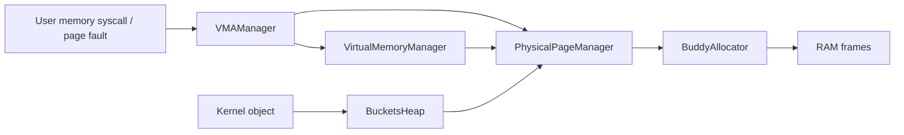

# Memory management

[Documentation home](../README.md) · [System map](../Architecture/System.md)

The memory subsystem answers three separate questions: which physical frames are owned, which virtual addresses are valid, and where kernel objects can be allocated. Its managers share ownership information, but serve different callers.

## Physical frames

`PhysicalPageManager<BuddyAllocator>` manages RAM frames. It reserves boot-owned ranges, maintains one `FrameInfo` record per 4 KiB frame and delegates free-block allocation to the buddy allocator.

The buddy allocator splits power-of-two blocks to satisfy allocations and coalesces compatible free buddies when blocks are released. A request for contiguous pages therefore depends on available block sizes as well as total free RAM.

### Ownership and metadata

| Field | Type | Meaning |
| --- | --- | --- |
| `ramStart`, `ramSize` | `UInt64` | Discovered physical RAM extent. |
| `framesMetadata` | `UnsafeMutablePointer<FrameInfo>?` | Per-frame metadata array. |
| `totalPages`, `allocatedPages` | `UInt64` | Capacity and allocated-frame accounting. |
| `FrameInfo.refCount` | `UInt32` | References to a frame. |
| `FrameInfo.flags` | `PhysicalPageFlags` | Allocation purpose and ownership flags. |
| `FrameInfo.heapState` | `UInt16` | Slab free count or allocation bitmap, depending on bucket size. |
| `FrameInfo.orderAndShift` | `UInt8` | Packed buddy order and slab size shift. |

`PhysicalPage` is an ownership-bearing allocation value. Consuming free operations transfer that ownership to the manager. Shared mappings use retain/release accounting; callers must not substitute a raw free for releasing one reference.

The all-zero `FrameInfo` representation means free, unowned and without a heap role. The packed fields target an 8-byte record stride. Kernel, allocator metadata, stacks and embedded initrd reservations are accounted for before normal allocation.

See [RAM layout](../Architecture/Memory.md) for where these allocations fit.

### Main interfaces

| Function | Parameters | Returns | Meaning |
| --- | --- | --- | --- |
| [<code>PhysicalPageManager.alloc(_:flag:heapShift:)</code>](../../Sources/ReixKernel/Memory/Physical/PhysicalPageManager.swift#L70) | <code>_ bytes : Int, flag : PhysicalPageFlags = .none, heapShift: UInt8 = 0</code> | <code>PhysicalPage; throws(PPMError)</code> | Allocates a physical block large enough for the byte request; throws on allocation or validation failure. |
| [<code>PhysicalPageManager.free(_:)</code>](../../Sources/ReixKernel/Memory/Physical/PhysicalPageManager.swift#L163) | <code>_ page: consuming PhysicalPage</code> | <code>Void; throws(PPMError)</code> | Returns a consumed allocation to the allocator after ownership checks. |
| [<code>PhysicalPageManager.retain(_:)</code>](../../Sources/ReixKernel/Memory/Physical/PhysicalPageManager.swift#L204) | <code>_ address: PhysicalAddress</code> | <code>Void; throws(PPMError)</code> | Adds a frame reference; throws if the address or reference state is invalid. |
| [<code>PhysicalPageManager.release(_:)</code>](../../Sources/ReixKernel/Memory/Physical/PhysicalPageManager.swift#L233) | <code>_ address: PhysicalAddress</code> | <code>Void; throws(PPMError)</code> | Drops a frame reference and handles the last reference. |
| [<code>PhysicalPageManager.reclaimDeviceTree()</code>](../../Sources/ReixKernel/Memory/Physical/PhysicalPageManager.swift#L300) | <code>—</code> | <code>UInt64; throws(PPMError)</code> | Returns the number of reclaimed bytes; called after boot no longer needs DTB storage. |

## Address spaces and regions

`VirtualMemoryManager` manages translation tables. `VMAManager` records the valid regions inside an address space and implements their backing, permissions, cloning and retirement. A virtual reservation and a resident physical page are separate states.

### Layers

| Layer | State | Responsibility |
| --- | --- | --- |
| `VirtualMemoryManager` | Kernel/identity roots, physical mapping offset, ASID allocator | Install, replace, protect, query and remove page translations. |
| `AddressSpace` | Root-table physical address, ASID, optional VMA manager | Associate a process with its mappings and fault-resolution path. |
| `VMAManager` | Region list and memory-manager pointers | Track program break, mapped ranges and resident-page accounting. |
| `VirtualMemoryArea` and region backing | Bounds, permissions and backing information | Describe why an address is valid and how a missing page can be supplied. |
| `UserMemory` | Validated access helpers | Check user ranges before kernel copies or accesses. |

### Region operations

`brk` changes the program-break reservation. `mmap` creates an anonymous region; `munmap` removes mappings and their reservation. `decommit` releases resident backing while preserving the virtual reservation so that later accesses can fault in backing again.

Fault handling checks the VMA and fault cause before supplying backing or resolving a copy-on-write mapping. A successful translation lookup alone does not establish that a caller may write a range.

Long unmap/decommit operations can retain explicit progress state and resume through the syscall path. Address-space teardown and rollback use completion-only cleanup paths. See [Preemption](Scheduling.md).

Addresses and limits are listed in [Memory layout](../Architecture/Memory.md). Raw page-table operations are internal mechanisms; userland reaches them through validated syscalls.

### Page-table mutation contract

| Operation | Required prior state | Result / responsibility |
| --- | --- | --- |
| `installUserPage` | No valid leaf at the address. | `Void`, throws `PPMError`; refuses an existing mapping. |
| `protectUserPage` | Valid leaf with the same memory attributes. | `Void`, throws `PPMError`; preserves the frame and changes permissions. Default behavior invalidates the cached translation. |
| `replaceUserPage` | Valid leaf naming a different frame. | `Void`, throws `PPMError`; uses the break-before-make sequence. |
| `removeUserPage` | A leaf may be present or absent. | `Bool`; clears a present descriptor. The retirement caller completes invalidation before the frame can be reused. |

`protectUserPage(invalidate: false)` is used for a batch whose caller performs the later flush. That contract depends on the parent process not executing during the change. It is not a general permission to defer invalidation across concurrent execution.

### Main interfaces

| Function | Parameters | Returns | Meaning |
| --- | --- | --- | --- |
| [<code>VirtualMemoryManager.createAddressSpace()</code>](../../Sources/ReixKernel/Memory/Virtual/VirtualMemoryManager.swift#L307) | <code>—</code> | <code>AddressSpace; throws(PPMError)</code> | Creates a user address space with a new translation root and ASID. |
| [<code>VirtualMemoryManager.destroyAddressSpace(addressSpace:)</code>](../../Sources/ReixKernel/Memory/Virtual/VirtualMemoryManager.swift#L339) | <code>addressSpace: consuming AddressSpace</code> | <code>Void; throws(PPMError)</code> | Destroys a consumed address space and releases its translation resources. |
| [<code>VirtualMemoryManager.physicalAddressOf(rootTable:virtual:)</code>](../../Sources/ReixKernel/Memory/Virtual/VirtualMemoryManager.swift#L747) | <code>rootTable: PhysicalAddress, virtual : VirtualAddress</code> | <code>PhysicalAddress?</code> | Returns the mapped physical address, or `nil` if no translation exists. |
| [<code>VirtualMemoryManager.removeUserPage(rootTable:virtual:)</code>](../../Sources/ReixKernel/Memory/Virtual/VirtualMemoryManager.swift#L663) | <code>rootTable: PhysicalAddress, virtual : VirtualAddress</code> | <code>Bool</code> | Clears a present leaf descriptor and reports whether it changed. The caller must finish TLB invalidation before reusing its address or frame. |
| [<code>AddressSpace.handlePageFault(at:cause:)</code>](../../Sources/ReixKernel/Process/AddressSpace.swift#L48) | <code>at address: VirtualAddress, cause : FaultCause</code> | <code>Bool</code> | Returns whether the fault was resolved and execution may retry. |

## Kernel allocations

`BucketsHeap` allocates kernel objects over `SlabCore<PPMBackend>`. Small allocations use power-of-two buckets backed by 4 KiB pages; larger allocations use physical blocks. `PPMBackend` connects the shared slab algorithm to the kernel's physical-memory manager.

### API choice

Use `kmallocOrNil` when the caller can report allocation failure. `kmalloc` enters the panic path if allocation cannot be satisfied. Typed overloads calculate a checked byte count and bind the returned storage to the requested type; allocation is separate from initializing that storage.

`kfree` requires a pointer obtained from the corresponding allocator and the correct ownership. The aligned runtime allocation helper preserves the allocation's block-head pointer so ordinary freeing remains valid.

### Accounting

| Property | Type | Meaning |
| --- | --- | --- |
| `metricsLiveBytes` | `UInt64` | Rounded capacity of live allocations. |
| `metricsLiveHighWaterBytes` | `UInt64` | Maximum observed live allocation capacity. |
| `metricsReservedBytes` | `UInt64` | Physical backing retained by slabs and large blocks. |
| `metricsReservedHighWaterBytes` | `UInt64` | Maximum observed retained backing. |

Live bytes and reserved bytes answer different questions: a slab page can retain free slots between allocations. `SlabCore` is shared with userland; each side supplies its own page backend.

### Main interfaces

| Function | Parameters | Returns | Meaning |
| --- | --- | --- | --- |
| [<code>BucketsHeap.kmalloc(_:errorMessage:)</code>](../../Sources/ReixKernel/Memory/Heap/BucketsHeap.swift#L49) | <code>_ size : UInt, errorMessage: StaticString = "Kmalloc Failed"</code> | <code>UnsafeMutableRawPointer</code> | Returns raw storage; panics when allocation fails. |
| [<code>BucketsHeap.kmallocOrNil(_:)</code>](../../Sources/ReixKernel/Memory/Heap/BucketsHeap.swift#L71) | <code>_ size: UInt</code> | <code>UnsafeMutableRawPointer?</code> | Returns raw storage, or `nil` on failure. |
| [<code>BucketsHeap.kfree(_:)</code>](../../Sources/ReixKernel/Memory/Heap/BucketsHeap.swift#L118) | <code>_ ptr: UnsafeMutableRawPointer</code> | <code>Void</code> | Releases the raw allocation. |
