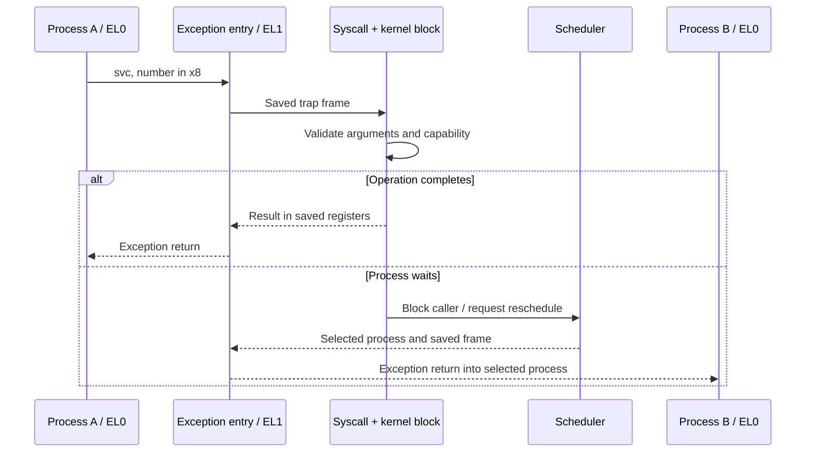

# Kernel overview

[Documentation home](../README.md) · [System map](../Architecture/System.md) · [RAM](../Architecture/Memory.md) · [Disk](../Architecture/Storage.md)

ReixOS is an AArch64 capability microkernel written mainly in Embedded Swift. The kernel runs at EL1. Processes and services run at EL0 and access privileged operations through syscalls and process-local capability handles.

The current scheduling unit is `Process`: one record contains the saved execution context, address space, scheduling state and IPC state. Separate native threads, a dynamic TCB registry and userland M:N tasks belong to the [future concurrency design](../Concurrency.md).

## Kernel blocks

| Block | What it owns | When it runs |
| --- | --- | --- |
| [Boot](Boot.md) | Platform discovery and initial manager composition | Before entering `Init`. |
| [Memory](Memory.md) | Physical frames, page tables, VMAs and kernel allocations | Allocation, mapping, faults and cleanup. |
| [Processes](Processes.md) | Process lifetime, parent/child links, suspended-task configuration | Creation, launch, exit and termination. |
| [Scheduling](Scheduling.md) | Runnable/waiting queues, slices and deadlines | Timer ticks, blocking, waking and exception return. |
| [IPC and capabilities](IPC.md) | Endpoints, messages, object authority and target references | Communication, delegation and release. |
| [Interrupts](Interrupts.md) | GIC control, timer IRQs and delivery to user-owned devices | Hardware interrupts and IRQ syscalls. |
| [Syscalls](Syscalls/README.md) | Validation and dispatch at the EL0/EL1 boundary | `svc` from userland. |

The kernel also provides logs, panic reports, trace/statistics export and minimal runtime support. These support the blocks above; they are not separate services or independent schedulers.

## One trip through the kernel

A timer IRQ may request a switch while the kernel is executing. The handler changes process context only at a suitable outer return boundary. Long memory operations can preserve explicit progress instead of keeping a separate suspended kernel stack per process.

## Architecture boundary

`Arch` selects `AArch64`. Swift controls scheduling, memory ownership and IPC. Assembly saves/restores registers, establishes boot state and performs privileged transitions.

| Boundary | Source |
| --- | --- |
| Initial CPU and stack setup | [boot.S](../../Sources/ReixKernel/Arch/aarch64/Boot/boot.S) |
| Exception vectors and register preservation | [ContextSaving.S](../../Sources/ReixKernel/Arch/aarch64/Exceptions/Handlers/ContextSaving.S) |
| Initial/context transition | [ContextSwitch.S](../../Sources/ReixKernel/Arch/aarch64/ContextSwitch/ContextSwitch.S) |
| Swift exception dispatch and switching | [ExceptionHandler.swift](../../Sources/ReixKernel/Arch/aarch64/Exceptions/Handlers/ExceptionHandler.swift) |
| Generated assembly and user syscall shims | [AsmRoutines.swift](../../Plugins/reix/AsmRoutines.swift) |

The present boot path reserves one 24 KiB kernel stack and one 16 KiB emergency exception stack. The global scheduler/managers do not establish an implemented SMP design; see the [memory map](../Architecture/Memory.md).

## Diagnostics and support

Logs use `LogRing` and `SerialTransmitQueue`; fatal exceptions enter the panic reporter. `FrameWalker` and `StackUsage` inspect stack state. Trace categories, sampling and `TraceExport` provide observations under profiler capability checks. FP/SIMD and runtime probes are conditional builds.

[Diagnostics sources](../../Sources/ReixKernel/Diagnostics), [architecture primitives](../../Sources/ReixKernel/Arch), [intrusive collections](../../Sources/ReixKernel/RXCore) and [linker/memory helpers](../../Sources/ReixKernel/Support) are linked directly where their declarations already explain their purpose.

## Current boundaries

The kernel includes an embedded tar filesystem and an ELF loader for bootstrap. The persistent filesystem, virtio-block driver, terminal services and ordinary application-launch policy run in userland. Both facts are part of the current architecture.

This documentation describes the checked source, including fixed-capacity tables. It does not claim that the future concurrency proposal or runtime performance targets have been implemented.
