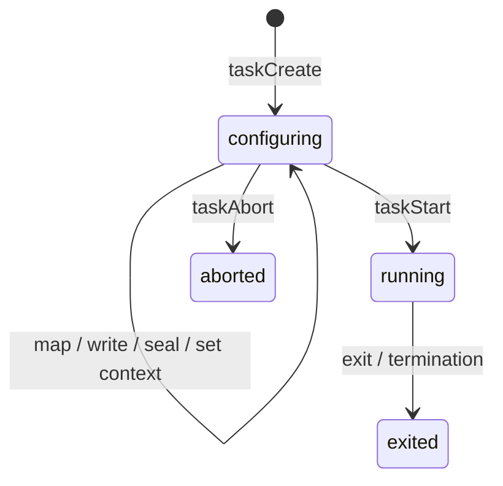

# Processes and controlled launch

[Documentation home](../README.md) · [System map](../Architecture/System.md)

## Process ownership and lifetime

`Process` is the current scheduling and address-space unit. It contains the saved CPU context, run state, accounting and IPC wait state. `ProcessMetadata` holds capabilities and colder lifecycle information. There is no separate implemented native-thread/TCB abstraction yet.

`ProcessManager` creates processes, releases address spaces, terminates processes and maintains the process-statistics index. Family links track parents and children; scheduler links track queue membership. Those are separate relationships even though they share one process record.

### Important fields

| Field | Type | Meaning |
| --- | --- | --- |
| `pid` | `PID` (`UInt64`) | Process identifier. |
| `identity` | `Identity` (`UInt32`) | Principal identifier used by IPC and ownership checks. |
| `context` | `UnsafeMutablePointer<Arch.TrapFrame>?` | Saved execution frame. |
| `status` | `ProcessStatus` | New, runnable, running, waiting, IPC-blocked or terminated. |
| `addressSpace` | `AddressSpace` | User translations and VMAs. |
| `metadata` | `UnsafeMutablePointer<ProcessMetadata>!` | Capability table, image metadata, name and exit information. |
| `cpuTime`, `scheduledAt` | `UInt64` | Closed CPU slices and the counter value at the start of an open slice. |
| `quantumLeft` | `UInt8` | Ticks left in the process's slice. See [Scheduling](Scheduling.md). |
| `readyCause`, `readySince` | `ReadyCause`, `UInt64` | Why and since when a woken process is waiting to run; settled into the latency worst cases when it gets the CPU. |
| `pending` | `PendingMessage?` | Pending IPC state. |
| `family` | `ProcessRelations` | Parent and child links. |
| `kernelDeadline*` | Deadline, order, index and kind | Membership in the shared deadline queue. |

### Creation and termination

The kernel still contains a bootstrap path that loads a named ELF from the embedded tar archive. The suspended-task path instead creates an empty process for a userland loader. Both exist in the current checkout; [ProcessServer](../Userland/ProcessLaunch.md) handles the ordinary disk-backed application path.

Termination removes scheduling and IPC participation and releases resources according to the process/task lifecycle. `killProcess` and `abortTask` release the capability table one held slot per step under the teardown preemption region, so a long table does not keep interrupts masked. An exit status can outlive an address space until the relevant parent or job observer consumes it. Kernel cleanup and userland supervision are different responsibilities.

`ProcessStatsIndex` maintains an intrusive AVL index for bounded traversal. It is not the scheduler's ready queue. See [Task control](Processes.md) for generation-checked handles and [Scheduling](Scheduling.md) for execution.

### Main interfaces

| Function | Parameters | Returns | Meaning |
| --- | --- | --- | --- |
| [<code>ProcessManager.spawnProcess(path:)</code>](../../Sources/ReixKernel/Process/ProcessManager.swift#L112) | <code>path: UnsafePointer&lt;CChar&gt;</code> | <code>UnsafeMutablePointer&lt;Process&gt;; throws(ProcessManagerError)</code> | Loads an initrd ELF and returns a process pointer, or throws a process-manager error. |
| [<code>ProcessManager.spawnProcess(name:nameLength:)</code>](../../Sources/ReixKernel/Process/ProcessManager.swift#L287) | <code>name : InlineArray&lt;16, UInt8&gt;? = nil, nameLength: Int = 0</code> | <code>UnsafeMutablePointer&lt;Process&gt;; throws(ProcessManagerError)</code> | Creates an empty process record/address space for controlled configuration. |
| [<code>ProcessManager.killProcess(_:reason:context:)</code>](../../Sources/ReixKernel/Process/ProcessManager.swift#L526) | <code>_ process: UnsafeMutablePointer&lt;Process&gt;, reason : ExitReason, context: SyscallContext</code> | <code>Bool</code> | Attempts termination of the selected process and reports success. |
| [<code>ProcessManager.isAlive(identity:)</code>](../../Sources/ReixKernel/Process/ProcessManager.swift#L681) | <code>identity: Identity</code> | <code>Bool</code> | Reports whether that principal is still alive. |
| [<code>Process.takePending()</code>](../../Sources/ReixKernel/Process/Process.swift#L194) | <code>—</code> | <code>PendingMessage?</code> | Returns and clears the pending IPC message. |

## Configuring a task before execution

The task-control API lets a userland loader construct a process before it can run. A generation-checked `TaskControl` names a record in `TaskRegistry`; the capability target determines whether the holder can configure a suspended task or control an existing job.

### Lifecycle

Starting requires a complete, valid configuration. Mapping bounds, write ranges, permissions, entry point, stack and program break are checked before scheduling. Configuration uses separate map, copy and seal operations rather than allowing the loader to modify arbitrary running address spaces.

### Record and limits

The registry keeps a compact live record per task. Everything only a task still being configured reads lives in a separate construction cell.

| State | Type / limit | Purpose |
| --- | --- | --- |
| `TaskControl.slot` | `UInt8` | Registry slot, the index into the table. |
| `TaskControl.generation` | `UInt32` | Distinguishes reused slots; kept in a separate array that outlives the record. |
| Registry | 32 records of 32 bytes each | Fixed current capacity. Read and updated in place, never copied out and back. |
| `TaskRecord.owner` | `Identity` | Principal responsible for configuration. |
| `TaskRecord.capabilityReferences` | `UInt16` | References from task/job capabilities. |
| `TaskRecord.process` | `UnsafeMutablePointer<Process>?` | Live process, when present. |
| `TaskRecord.lifecycle` | `TaskLifecycle` | `configuring`, `running`, `exited` or `aborted`. `configuring` carries a pointer to the task's `TaskConstruction`. |
| `TaskConstruction.regions` | Up to 32 per task | Checked configuration regions and their sealed state. |
| `TaskConstruction.contextSet` | `Bool` | Whether a valid initial context has been installed. |
| `TaskConstruction.budget` | `FrameBudget` pointer | The owner's budget, charged one frame for the cell and holding a reference so the refund has somewhere to land. |
| One mapping request | Up to 1024 pages | `TaskABI.maximumPagesPerMapping`. |
| One write request | Up to 64 KiB | `TaskABI.maximumWriteBytes`. |

`TaskConstruction` is a kernel-heap cell made by `taskCreate`, so a started or finished task costs 32 bytes and not the region table it no longer reads. Because it is kernel memory a process makes the kernel hold for as long as it leaves a task unstarted, one frame is charged to the owner's `FrameBudget` before the cell is allocated, and `taskCreate` fails without taking a slot, a frame or heap when the budget refuses. The cell is released, and the frame refunded, on every way out of `configuring`:

| Exit from `configuring` | Where |
| --- | --- |
| Start | `startTask`, after the readiness check and once the task is marked running. |
| Abort, including the owner's death | `abortTask`. |
| Exit before start | The process-exit path, through `TaskRegistry.markExited`. |
| A seal the construction disagrees with | `sealTaskRegion` aborts the task. |
| A create that cannot get a process or a slot | `createSuspendedTask`, before it returns. |

The lifecycle enum carries the pointer, so no state other than `configuring` can name a cell that was already given back.

These limits describe today's implementation. The dynamic TCB budget in [Concurrency](../Concurrency.md) is a future design and does not change this registry.

### Main interfaces

| Function | Parameters | Returns | Meaning |
| --- | --- | --- | --- |
| [<code>ProcessManager.createSuspendedTask(ownedBy:name:nameLength:frameLimit:)</code>](../../Sources/ReixKernel/Process/ProcessManager+Tasks.swift#L18) | <code>ownedBy owner: UnsafeMutablePointer&lt;Process&gt;, name : InlineArray&lt;16, UInt8&gt;? = nil, nameLength : Int = 0, frameLimit : UInt32? = nil</code> | <code>(control: TaskControl, process: UnsafeMutablePointer&lt;Process&gt;)?</code> | Charges the owner one frame for the construction cell, then returns the control token and process; `nil`, with nothing held, if the budget, the process or a registry slot is refused. |
| [<code>ProcessManager.mapTaskAnonymous(_:at:pages:)</code>](../../Sources/ReixKernel/Process/ProcessManager+Tasks.swift#L52) | <code>_ control : TaskControl, at address: VirtualAddress, pages : UInt32</code> | <code>TaskResult</code> | Creates a checked anonymous configuration region; returns a typed status. Fills it one page per step under the `[TMAP]` preemption region, and each step undoes its own charge and frame if it fails. |
| [<code>ProcessManager.writeTask(_:at:from:count:)</code>](../../Sources/ReixKernel/Process/ProcessManager+Tasks.swift#L113) | <code>_ control : TaskControl, at address : VirtualAddress, from source: VirtualAddress, count : UInt64</code> | <code>TaskResult</code> | Copies bytes from the caller into a writable configuration region. |
| [<code>ProcessManager.sealTaskRegion(_:at:pages:permissions:)</code>](../../Sources/ReixKernel/Process/ProcessManager+Tasks.swift#L174) | <code>_ control : TaskControl, at address : VirtualAddress, pages : UInt32, permissions: TaskMemoryPermissions</code> | <code>TaskResult</code> | Finalizes a region’s protection and rejects conflicting permissions. |
| [<code>ProcessManager.startTask(_:context:)</code>](../../Sources/ReixKernel/Process/ProcessManager+Tasks.swift#L254) | <code>_ control: TaskControl, context : SyscallContext</code> | <code>TaskStartResult</code> | Transitions a fully configured task into execution and reports its result. |
| [<code>ProcessManager.taskStatus(_:)</code>](../../Sources/ReixKernel/Process/ProcessManager+Tasks.swift#L315) | <code>_ control: TaskControl</code> | <code>TaskStatus</code> | Returns the task state and exit information represented by the control token. |
