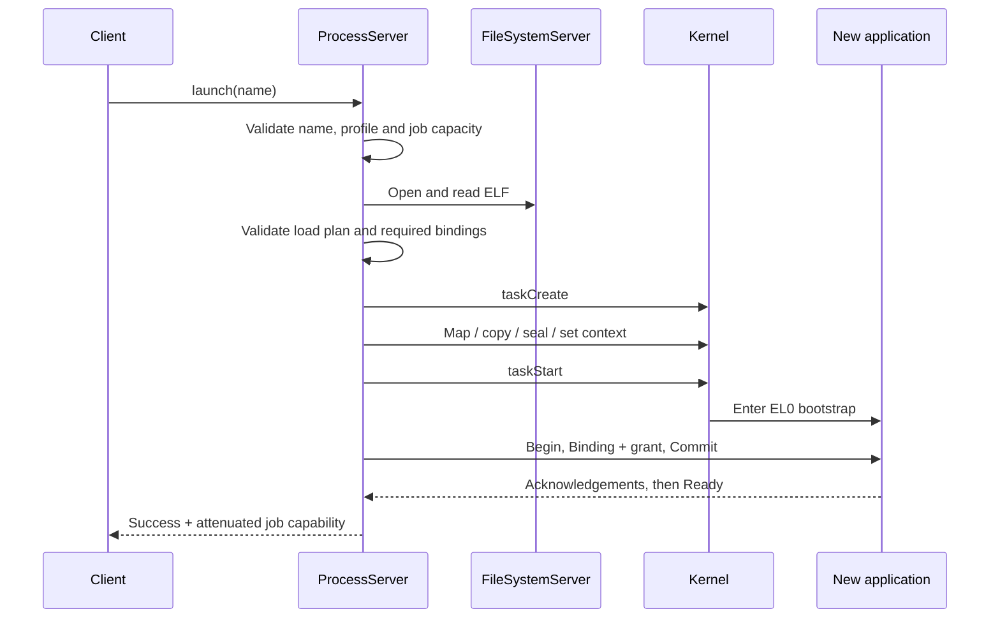

# Application launch and supervision

[Documentation home](../README.md) · [Task syscalls](../Kernel/Syscalls/Processes.md) · [Service protocols](../ABI/Services.md)

`ProcessServer` launches supported applications from its filesystem capability. It validates an ELF and prepares its environment before publishing a job to the caller. The kernel supplies suspended-task construction and lifecycle controls; it does not interpret the disk-backed application's pathname or program profile.

The kernel's initrd ELF loader remains in use for bootstrap services, including ProcessServer itself.

## Launch sequence

`taskStart` precedes the environment handshake: the child must execute its bootstrap receiver. Success is returned to the launch client only after `Ready`. A malformed ELF or unavailable required binding is rejected before task creation/start; a later handshake failure cancels and cleans up the started job.

## Policy and mechanism

| Component | Owns |
| --- | --- |
| `ELFPlanner` | Segment validation, bounded copy/region plan and initial entry/program-break calculation. |
| `ProgramProfile` | Supported executable names and the environment bindings/rights they may receive. |
| `ProcessServer` | Filesystem lookup, construction sequence, bootstrap transaction and job supervision. |
| `Environment` | Child-side binding validation, staged environment and readiness acknowledgement. |
| Kernel task API | Address-range/protection checks, initial context and state transitions. |

The current request allows at most 12 name bytes. A name must match a supported `ProgramProfile`; this is not yet a general arbitrary-path launcher. The environment protocol allows up to 16 bindings.

## Useful interfaces

| Function | Parameters | Returns | Meaning |
| --- | --- | --- | --- |
| `launchProgram` | `through: UInt32`, `name: UnsafePointer<UInt8>`, `length: Int` | `ProcessLaunchResult` | Launch status and optional job capability. |
| `ELFPlanner.plan` | `from: inout Source`, where `Source: ELFByteSource` | `Result<ELFLoadPlan, ELFPlanError>` | Validated load plan or a parsing/validation error. |
| `ELFLoadPlan.region(at:)` | `Int` | `ELFLoadRegion?` | Planned region at an index, if present. |
| `ELFLoadPlan.copy(at:)` | `Int` | `ELFCopy?` | File-to-memory copy at an index, if present. |
| `jobStatus` | Job handle `UInt32` | `TaskStatus` | Current state and exit information. |
| `jobCancel` | Job handle `UInt32` | `TaskResult` | Requests termination through the granted job authority. |
| `waitForJob` | Job handle and polling interval in milliseconds | `TaskStatus` | Polls until exited, aborted or invalid. |

## State worth understanding

`ELFLoadPlan` contains `entry`, `programBreak`, image-page count and bounded region/copy counts. `ELFLoadRegion` contains an address, page count and final permissions. `ELFCopy` contains file offset, virtual destination and byte count.

ProcessServer retains its supervision handle and PID. The caller receives only `.taskTerminate` and `.taskStatus` rights. The one-time bootstrap endpoint is dropped after readiness; longer-lived session control has its own endpoint.

A job capability preserves observation/control authority; it is not a copy of the process or a second execution context. Kernel resource cleanup remains separate from ProcessServer's decision about what to supervise or launch next.

## Source entry points

[ProcessServer](../../Sources/Userland/ProcessServer/ProcessServer.swift), [ELF planner](../../Sources/Userland/ProcessServerCore/ELFPlanner.swift), [program profiles](../../Sources/Userland/ProcessServerCore/ProgramProfile.swift), [client](../../Sources/Reix/Services/ProcessServer/ProcessServerClient.swift), [environment receiver](../../Sources/Reix/Services/Runtime/Environment.swift).
