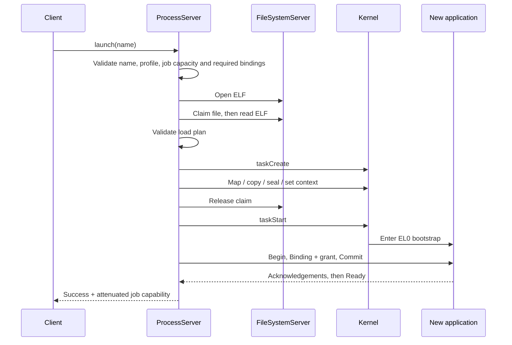

# Application launch and supervision

[Documentation home](../README.md) · [Task syscalls](../Kernel/Syscalls/Processes.md) · [Service protocols](../ABI/Services.md)

`ProcessServer` launches supported applications from its filesystem capability. It validates an ELF and prepares its environment before publishing a job to the caller. The kernel supplies suspended-task construction and lifecycle controls; it does not interpret the disk-backed application's pathname or program profile.

The kernel's initrd ELF loader remains in use for bootstrap services, including ProcessServer itself.

## Launch sequence

`taskStart` precedes the environment handshake: the child must execute its bootstrap receiver. Success is returned to the launch client only after `Ready`. A malformed ELF, a program file somebody else is changing or an unavailable required binding is rejected before task creation/start; a later handshake failure cancels and cleans up the started job.

## Loading a program under a claim

The load plan comes from the ELF headers and the bytes from the segments, many reads apart. So ProcessServer claims the program file before it reads the first header byte and lets it go once the task has been built and the last segment byte copied into it, always before `taskStart`, on every way out: a malformed image, a task that cannot be made or filled, a refusal, and success. It asks the file's size again under the claim, since the size `open` returned is from before it. The sequence is `ProgramLoad.load` in ProcessServerCore, over a `ProgramFile` that supplies `claim()` and `release()`.

| Situation | Launch status |
| --- | --- |
| Another client holds a claim on the file, such as a writer part way through replacing it | `busy`, answered at once. A claim is never waited for, because one ProcessServer loop sleeping on a writer would stall every other launch. |
| The file was removed between `open` and the claim | `notFound`. |
| The file system cannot be asked, or its view cannot claim | `unavailable`. |
| The holder of a claim has died | Nothing: the file system sweeps dead holders before it refuses. A ProcessServer that dies mid-load is swept the same way. |

ProcessServer's view of the program folder holds `FSRights.loader`: `lookup`, `read` and `claim`. It can read a program and hold it still, and cannot write one. While the claim is held, a remove or rename of the file by another client is refused as busy. The binding check runs before the claim, so a refusal that does not depend on the file holds nothing. On `busy` the shell prints that the program is being changed and to try again.

The diagnostic image alone accepts `Shell.die`, a launch that claims `Shell.elf` and exits during loading. Init reaps that sacrificial ProcessServer, checks that the file can be read and written again after the dead holder is swept, and starts a fresh server for the session. The request, helper and exit are compiled only under `REIX_BOOT_DIAGNOSTIC`. [check-loader-hook.sh](../../scripts/check-loader-hook.sh) runs after `make image` and `make release`; standard and verbose builds inspect both linked and stripped Init and ProcessServer ELFs for the diagnostic name.

Profile scenario markers are ordered only within their output stream. Init's endpoint-ready and application-ready reports retain their order; Shell statistics, Shell and ProcessServer identities, Shell-attributed marks and Shell completion are required independently of Init's readiness output. Mixed-profile terminal output, StorageCheck completion and the direct trace framing are checked separately. [The marker fixture](../../Tests/Scenarios/profile-authority.sh) accepts either readiness order and rejects missing or misattributed evidence.

## Policy and mechanism

| Component | Owns |
| --- | --- |
| `ELFPlanner` | Segment validation, bounded copy/region plan and initial entry/program-break calculation. |
| `ProgramLoad` | Claim, plan, build and release around one program file. |
| `ProgramProfile` | Supported executable names and the environment bindings/rights they may receive. |
| `ProcessServer` | Filesystem lookup, the claim on the program file, construction sequence, bootstrap transaction and job supervision. |
| `Environment` | Child-side binding validation, staged environment and readiness acknowledgement. |
| Kernel task API | Address-range/protection checks, initial context and state transitions. |

The current request allows at most 12 name bytes. A name must match a supported `ProgramProfile`; this is not yet a general arbitrary-path launcher. The environment protocol allows up to 16 bindings.

## Useful interfaces

| Function | Parameters | Returns | Meaning |
| --- | --- | --- | --- |
| `launchProgram` | `through: UInt32`, `name: UnsafePointer<UInt8>`, `length: Int` | `ProcessLaunchResult` | Launch status and optional job capability. |
| `ELFPlanner.plan` | `from: inout Source`, where `Source: ELFByteSource` | `Result<ELFLoadPlan, ELFPlanError>` | Validated load plan or a parsing/validation error. |
| `ELFLoadPlan.region(at:)` | `Int` | `ELFLoadRegion?` | Planned region at an index, if present. |
| `ELFLoadPlan.copy(at:)` | `Int` | `ELFCopy?` | File-to-memory copy at an index, if present. |
| `jobStatus` | Job handle `UInt32` | `TaskStatus` | Current state and exit information. |
| `jobCancel` | Job handle `UInt32` | `TaskResult` | Requests termination through the granted job authority. |
| `waitForJob` | Job handle and polling interval in milliseconds | `TaskStatus` | Polls until exited, aborted or invalid. |

## State worth understanding

`ELFLoadPlan` contains `entry`, `programBreak`, image-page count and bounded region/copy counts. `ELFLoadRegion` contains an address, page count and final permissions. `ELFCopy` contains file offset, virtual destination and byte count.

ProcessServer retains its supervision handle and PID. The caller receives only `.taskTerminate` and `.taskStatus` rights. The one-time bootstrap endpoint is dropped after readiness; longer-lived session control has its own endpoint.

A job capability preserves observation/control authority; it is not a copy of the process or a second execution context. Kernel resource cleanup remains separate from ProcessServer's decision about what to supervise or launch next.

## Source entry points

[ProcessServer](../../Sources/Userland/ProcessServer/ProcessServer.swift), [ELF planner](../../Sources/Userland/ProcessServerCore/ELFPlanner.swift), [program profiles](../../Sources/Userland/ProcessServerCore/ProgramProfile.swift), [client](../../Sources/Reix/Services/ProcessServer/ProcessServerClient.swift), [environment receiver](../../Sources/Reix/Services/Runtime/Environment.swift).
