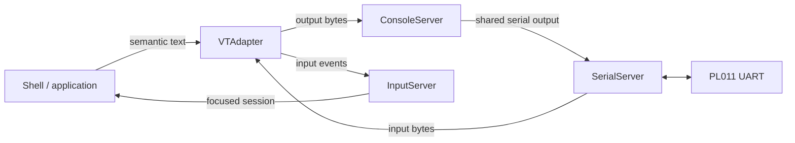
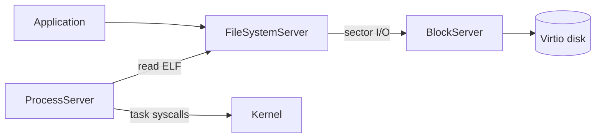

# Services and applications

[Documentation home](../README.md) · [Userland overview](Overview.md) · [Service protocols](../ABI/Services.md)

`Init` assembles the system by launching services and granting the authority each one needs. Endpoints are passed explicitly; NameServer is available for named publication, but not every service is registered there.

## Service responsibilities

| Component | What it does | Authority / state that matters |
| --- | --- | --- |
| [Init](../../Sources/Userland/Init) | Boots services, distributes capabilities and coordinates the session. | Initial device, spawn, clock, profiler and storage authority. |
| [SerialServer](../../Sources/Userland/SerialServer) | Operates the UART byte transport and shared serial rings. | UART mapping, IRQ set, reader/writer sessions. |
| [ConsoleServer](../../Sources/Userland/ConsoleServer) | Provides output transport through the serial writer. | Serial-writer capability and per-client output state. |
| [InputServer](../../Sources/Userland/InputServer) | Routes input events and maintains focus/session ownership. | Source, consumer and focus roles. |
| [VTAdapter](../../Sources/Userland/VTAdapter) | Connects semantic text surfaces to terminal byte output and serial input. | Console transport, serial reader and input-source capability. |
| [NameServer](../../Sources/Userland/NameServer) | Publishes and resolves named endpoints. | Registry state and registration/lookup authority. |
| [VirtioBus](../../Sources/Userland/VirtioBus) | Walks authorized virtio-MMIO transports and starts the block driver. | Bus authority; derived device and IRQ capabilities. |
| [BlockServer](../../Sources/Userland/BlockServer) | Runs the virtio-block driver and serves queued sector I/O. | Device/IRQ/DMA authority, four request slots, volume owner. |
| [FileSystemServer](../../Sources/Userland/FileSystemServer) | Mounts RxFS and serves object/container operations. | Disk endpoint, filesystem state, client sessions and scoped rights. |
| [ProcessServer](../../Sources/Userland/ProcessServer) | Loads supported applications from the programs directory and supervises jobs. | Programs directory, task creation, selected environment grants and job table. |

## Terminal flow

The adapter coordinates terminal presentation. InputServer owns input routing/focus. SerialServer owns byte transport. Kernel boot/panic output remains a separate low-level path to the UART.

## Storage and launch flow

Init gives FileSystemServer the disk endpoint and passes scoped filesystem capabilities upward. The programs namespace is rooted at `system/programs`. Missing storage or program-directory authority can prevent ordinary application launch without changing the kernel's initrd bootstrap path.

## Applications and reusable logic

| Component | Role |
| --- | --- |
| [Shell](../../Sources/Userland/Shell) | Interactive command execution, pipelines, sessions and rendering. |
| [ShellLanguage](../../Sources/Userland/Shell/Language) | Shared parsing, typed values, analysis, catalog, completion and editing logic. |
| [Top](../../Sources/Userland/Top) | Consumes process/system statistics and trace export for display. |
| [StorageCheck](../../Sources/Userland/StorageCheck) | Dedicated storage exercise/diagnostic program. |
| [ReixFS](../../Sources/ReixFS) | On-disk filesystem implementation used by FileSystemServer. |
| [ProcessServerCore](../../Sources/Userland/ProcessServerCore) | ELF validation/load planning and program profiles. |

The Shell's internal parser/editor helpers are linked as a block: their existence does not add another kernel component. See [Process launch](ProcessLaunch.md) and [Storage](Storage.md) for the cross-component contracts.
